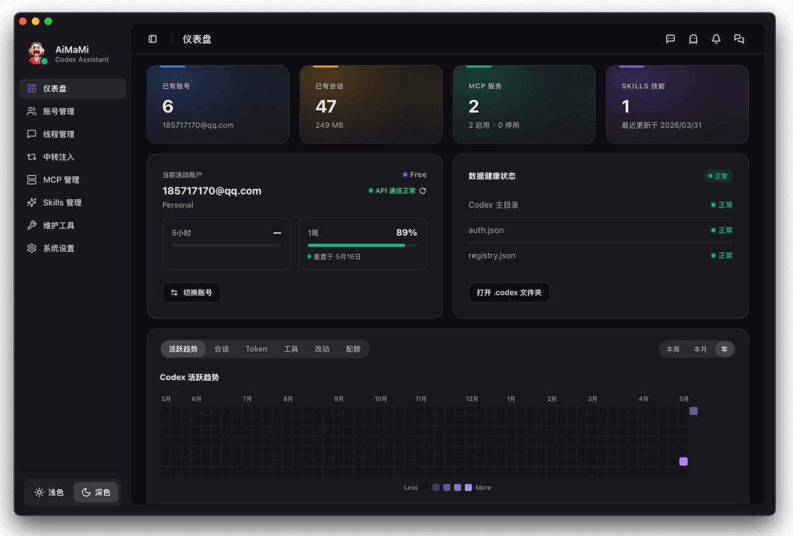

> **AgentHarbor:** an independent rebuild with its own application identity, local data directory, smart-router namespace, and default port. It can run alongside an installed AiMaMi release.

<p align="center">
  
</p>

<h1 align="center">AgentHarbor</h1>

<p align="center">
  <strong>A native desktop harbor for coding agents — manage accounts, routing, sessions, and local configuration in one place.</strong>
</p>

<p align="center">
  English · <a href="./README-cn.md">简体中文</a>
</p>

---

## Overview

Codex stores accounts, sessions, MCP entries, Skills, smart-router settings, and relay configuration across multiple files under `~/.codex`. Multi-account switching, quota exhaustion, third-party model setup, session cleanup, and config drift quickly turn day-to-day work into hand-editing TOML, JSON, and SQLite.

AgentHarbor is built with **Tauri 2, React, and Rust**. Codex is the first supported agent; the product identity and provider-specific modules are kept separate so adapters such as Claude Code can be added later. Today it consolidates Codex workflows — including smart routing and relay management — into a single desktop app that reduces risky manual file edits.

---

## Core Capabilities

| Module | Available in this source build |
| --- | --- |
| **Account management** | Add accounts through Codex login, inspect quota, switch manually, and remove saved accounts |
| **Codex access** | Choose local Router or direct Native access independently of model protocol and network settings |
| **Relay management** | Provider defaults and per-model protocol overrides, connectivity tests, import/export, and diagnostics |
| **Session management** | List, search, filter, and export selected Codex conversations as Markdown or JSONL |
| **MCP / Skills** | Manage MCP entries and Skills lifecycle in the UI, with backup and restore |
| **Client configuration** | Preview, apply, and restore Claude Code / OpenCode provider settings through the local router |
| **Image workbench** | Generate or edit images with a configured provider and save results to a local gallery |
| **Custom instructions** | Manage only the AgentHarbor-managed block in `~/.codex/AGENTS.md`, with preview and rollback |
| **System maintenance** | Diagnose local state, clean redundant backups, rebuild the registry, and restart Codex |
| **Settings & runtime** | Theme, language, quota refresh, network proxy, optional update checks, and a basic tray menu |

**Not implemented in this source build:** automatic account switching, account import/export, bulk deletion of conversations, and plugin management. Disabled controls or historical screenshots do not enable these features. The maintenance cleanup action removes redundant local backups and stale registry entries; it does not delete conversations. Quota heatmaps and a macOS notch quota display are also unavailable. Update checks require a separately configured, signed release service.

**Model protocols:** Each model can use Responses, Chat Completions, or Anthropic Messages. The provider protocol is only an inherited default for models without an override; it does not filter the catalog. Refreshing the model list preserves overrides. Upstream protocol, Codex access mode, and network route are separate settings.

**Codex access modes:** Router forwards requests through AgentHarbor and converts Chat Completions / Anthropic Messages for the Codex Responses interface. It can combine official and enabled relay models; keep AgentHarbor running. Native connects directly to the current provider: the selected default must use Responses, and its catalog contains only included Responses models from that provider, using real upstream model IDs. An incompatible selection is rejected rather than silently changing the model or provider; Chat / Anthropic models require Router.

**Native authentication:** AgentHarbor stores the provider API key under a dedicated, randomly named variable in the Codex home `.env` file and refers to it through `env_key`. Treat `.env` and its backups as local secret files: protect access and keep them out of source control; they are not an encrypted credential vault. The key is not written to `auth.json` or exposed in config previews. Native sets `requires_openai_auth=false`, so Codex may hide the ChatGPT account even though the existing `auth.json` is preserved. To use official and relay models together with official account display, switch to Router with accountless mode off and restart Codex.

Restart Codex after changing access mode, model configuration, or its native network route. Use the AgentHarbor restart action to apply changed proxy settings to the Codex process. Native model requests do not require the local service to stay running; Claude Code / OpenCode configurations that use the local router still do.

See [running instructions](docs/RUNNING.md) for current feature boundaries, network modes, and isolated validation.

<p align="center">
  
</p>
## Platform Support

| Platform | Notes |
| --- | --- |
| macOS | Universal (Apple Silicon + Intel), macOS 12+ |
| Windows | x64, NSIS installer |
| Linux | Best-effort support for some workflows |

---

## Tech Stack

Tauri 2 · React 18 · TypeScript · Vite 6 · Tailwind CSS · shadcn/ui · Rust

---

## Quick Start

**Requirements:** Node.js · pnpm · Rust · [Tauri prerequisites](https://v2.tauri.app/start/prerequisites/)

```bash
cd AgentHarbor
pnpm install
pnpm tauri dev
```

```bash
pnpm build                                        # Frontend build check
cargo check --manifest-path src-tauri/Cargo.toml  # Rust check
pnpm tauri build                                  # Production build
```

---

## Project Structure

```text
src/           React frontend
src-tauri/     Tauri shell and Rust backend
src/locales/   i18n (en / zh)
scripts/       Build and release scripts
assets/        Branding and documentation assets
```

---

## Architecture

```text
React UI ── invoke() ──▶ Tauri commands ──▶ core/
                                              ├── ~/.codex          (Codex native)
                                              └── ~/.codex/agentharbor/ (AgentHarbor app data)
                         platform/            macOS / Windows implementations
```

Model capabilities and prices come from one resolver fed by a bundled
[models.dev](https://github.com/anomalyco/models.dev) snapshot plus an optional
runtime cache; see [docs/models-dev.md](docs/models-dev.md) for matching rules,
field precedence and the store migration.

---

## Contributing

Issues and pull requests are welcome. Please read [CONTRIBUTING.md](CONTRIBUTING.md) for development setup, validation steps, and local Codex data-safety guidance. For larger changes, open an issue first so the approach can be discussed early.

---

## License

[Apache License 2.0](LICENSE)

---

## Disclaimer

AgentHarbor is an independent tool for local Codex workflows. It is not affiliated with, endorsed by, or sponsored by OpenAI. Use third-party relay services at your own risk and comply with their terms of service.
