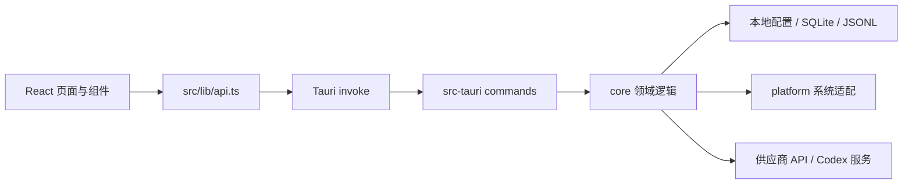

# AgentHarbor 代码结构与功能接口总览

> 依据仓库当前源码整理，日期：2026-09-28；已按 [CODE_REVIEW.md](CODE_REVIEW.md) 的勘误和随后的修复更新。本文描述代码中实际存在的页面、接口、主要数据流与能力边界；对能力边界会单独标出。

## 1. 项目概况

AgentHarbor 是面向 Codex 工作流的本地桌面应用。界面由 React + TypeScript 构成，桌面集成、文件操作、配置管理、本地代理和用量解析由 Tauri 2 + Rust 实现。它没有单独部署的 Web 后端；前端通过 Tauri IPC 调用 Rust 命令，Rust 再访问本机配置、会话数据库、客户端文件，或连接模型供应商。

| 层 | 技术与职责 | 入口 |
| --- | --- | --- |
| 桌面壳 | Tauri 2；主窗口、托盘、单实例、升级器和 IPC 命令注册 | `src-tauri/src/lib.rs`、`src-tauri/tauri.conf.json` |
| 前端 | React 18、TypeScript、Vite；导航、表单、统计视图和交互 | `src/main.tsx`、`src/main-app.tsx` |
| IPC 适配 | 将界面方法映射到 Tauri command，定义请求与返回类型 | `src/lib/api.ts`、`src/types/` |
| 命令层 | 校验/转换 IPC 参数、获取共享 Repository、调用领域逻辑 | `src-tauri/src/commands/` |
| 领域层 | 供应商路由、文件配置、用量、会话、备份恢复等 | `src-tauri/src/core/` |
| 平台层 | Windows/macOS/Linux 路径、进程、系统代理、托盘与更新差异 | `src-tauri/src/platform/` |

## 2. 启动与全局运行方式

### 前端启动链

1. `src/main.tsx` 创建 React 根节点并挂载错误边界。
2. `src/App.tsx` 转交给 `MainAppRoot`。
3. `src/main-app.tsx` 安装 TanStack Query、主题/背景/头像提供器、国际化和全局提示；路由是本地状态，不使用 URL 路由器。
4. 导航定义在 `src/components/layout/sidebar.tsx`，页面按需懒加载。切走页面时，过渡期间会暂时保留页面；访问过生图页后会继续挂载该页，以保持正在运行的生图任务。
5. `PageStage` 和 `SiteHeader` 管理页面滚动、标题与顶部全局状态；`CommandPalette` 提供全局快捷操作。

### Rust/Tauri 启动链

`src-tauri/src/main.rs` 进入 `agentharbor_lib::run()`。`src-tauri/src/lib.rs` 创建路径上下文和共享 `Mutex<Repository>`，注册 Tauri plugins 与 IPC commands，配置单实例、系统托盘和主窗口。托盘菜单与事件处理在 `src-tauri/src/commands/tray_menu.rs`，窗口聚焦在 `commands/hotspot.rs`。启动后异步协调本地路由与客户端配置，并启动自动切号后台循环；如果 Router 端口被其他进程占用，会把仍指向本地路由的客户端配置恢复原样，避免本地 token 发给占用端口的进程。退出（`RunEvent::Exit`）时恢复指向本地路由的 Claude Code/OpenCode 配置、撤销 Codex 路由注入并释放单实例资源。托盘退出、Windows 关机/注销（`WM_ENDSESSION`）、Unix 的 SIGTERM/SIGHUP/SIGINT 以及开发终端的 Ctrl+C 都会走这条退出路径；强杀（`kill -9`、任务管理器结束进程）或崩溃则不会，要等下次启动时协调。窗口关闭事件默认隐藏窗口，托盘可重新显示。

### 前端数据与错误处理

- `src/lib/api.ts` 内部 `invoke<T>` 动态载入 `@tauri-apps/api/core`。浏览器预览模式没有本地命令能力，调用时会抛出 `Command ... is only available in Tauri runtime`。
- `src/lib/query-client.ts` 集中配置 TanStack Query；页面以 query/mutation 维护加载、缓存、刷新和写操作状态。
- Rust `CoreEnvelope<T>` 在一部分接口中提供 `schemaVersion / success / code / message / warnings / data`。失败一律走 `Err(String)`，所以返回的 envelope 总是成功值，前端实际只读 `data` 与 `warnings`。供应商、图片、客户端配置等接口直接返回 DTO，错误是 i18n key；其余命令的错误是原始文本。
- 前端传入的 IPC 对象使用 camelCase；Rust 参数和字段采用 snake_case，并通过 Tauri/Serde 的命名规则对应。

## 3. 页面与功能索引

| 页面/功能 | 界面入口 | 主要用途 | 前端 API | Rust 命令/领域实现 |
| --- | --- | --- | --- | --- |
| 概览 | `src/components/overview/overview-page.tsx` | 显示路由、供应商、MCP、Skills、自定义指令和系统状态摘要；跳转常用功能、打开路径、重启 Codex、打开代理设置 | `loadSnapshot`、`providers.loadState`、`loadMcpServers`、`loadInstalledSkills`、`loadSkillBackups`、`loadCustomInstructionState`、`getSystemInfo`、`openPath`、`targets.restart` | `commands/system.rs`、`commands/newapi.rs`、`commands/mcp.rs`、`commands/skills.rs`、`commands/custom_instructions.rs`；对应 `core/repository.rs` 等 |
| 账号与用量 | `src/components/accounts/accounts-page.tsx`、`daily-trend-panel.tsx`、`model-usage-breakdown.tsx`、`recent-turns-panel.tsx`、`relay-usage-panel.tsx` | Codex 账号登录、列表、额度刷新、切换和删除；合并展示 Codex/Claude Code 本地日志与经过本地代理的请求用量；供应商余额 | `accounts.list/refresh/login/switch/delete`、`usage.overview`、`providers.loadState/queryBalance`、`targets.restart` | `commands/accounts.rs`、`commands/usage.rs`、`core/accounts.rs`、`core/account_monitor.rs`、`core/local_usage.rs`、`core/relay_usage.rs` |
| 中转与客户端配置 | `src/components/newapi/newapi-page.tsx`、`provider-dialog.tsx`、`provider-model-editor.tsx`、`provider-test-dialog.tsx`、`claude-model-config.tsx`、`client-configs.tsx`、`client-config-dialog.tsx` | 管理供应商、协议和单模型协议、模型列表、测试/余额、网络出口、Codex Router/Native 接入；配置 Claude Code、OpenCode 的原生或本地路由方式 | `providers.*`、`routing.*`、`targets.configs/previewConfig/applyConfig/restoreConfig/releaseConfig` | `commands/newapi.rs`、`commands/client_config.rs`；`core/router.rs`、`router_proxy.rs`、`routing_runtime.rs`、`protocol/`、`client_config/` |
| 图片工作台 | `src/components/image-workbench/image-workbench-page.tsx`、`src/lib/image-prompts.ts` | 选择供应商与模型、生成/编辑图片、管理任务画布、本地图库、选择图库目录、查看/另存/删除成图 | `image.generate/keyStatus/saveKey/saveFile/saveToGallery/setGalleryDirectory/listGallery/loadGalleryImage/loadGalleryThumbnail/deleteGalleryImage` | `commands/image.rs`；凭据经 `core/secret_file.rs` 存储，图片目录配置和成图写入本地磁盘 |
| 会话归档 | `src/components/threads/threads-page.tsx`、`thread-card.tsx`、`thread-group-header.tsx`、`virtual-thread-list.tsx`、`thread-recovery-dialog.tsx` | 扫描 Codex 会话、搜索筛选与分组、导出 Markdown/JSONL、删除会话、取消/恢复待处理删除、修复会话目录/索引状态 | `conversations.list/export/delete/cancelPendingDeletions/previewRecovery/applyRecovery` | `commands/threads.rs`、`commands/thread_recovery.rs`；`core/threads.rs`、`thread_delete.rs`、`thread_recovery.rs` |
| MCP 管理 | `src/components/mcp/mcp-page.tsx` | 读取、添加/编辑、启用/停用、删除 MCP server，并定位源配置 | `loadMcpServers/upsertMcpServer/setMcpServerEnabled/removeMcpServer/openPath` | `commands/mcp.rs`、`core/mcp.rs`；读写 Codex `config.toml` |
| Skills 管理 | `src/components/skills/skills-page.tsx` | 扫描已安装 Skills、导入、移除、浏览备份、恢复或删除备份 | `loadInstalledSkills/loadSkillBackups/importSkill/removeSkill/restoreSkillBackup/deleteSkillBackup/openPath` | `commands/skills.rs`、`core/skills.rs` |
| 自定义指令 | `src/components/custom-instructions/custom-instructions-page.tsx`、`history-list.tsx`、`preview-dialog.tsx`、`template-card.tsx`、`src/lib/custom-instruction-templates.ts` | 管理 `AGENTS.md` 中 AgentHarbor 标记的指令区块；模板预览、应用、清除和历史回滚 | `loadCustomInstructionState/previewCustomInstructionApply/applyCustomInstruction/clearCustomInstructionBlock/rollbackCustomInstruction` | `commands/custom_instructions.rs`、`core/custom_instructions.rs` |
| 系统维护 | `src/components/maintenance/maintenance-page.tsx` | 诊断本地环境、清理冗余账号备份/过期索引、重建账号 registry、重启 Codex | `diagnose/clean/rebuildRegistry/targets.restart` | `commands/system.rs`、`commands/targets.rs`、`core/repository.rs`、`platform/process.rs` |
| 设置 | `src/components/settings/settings-page.tsx`、`api-proxy-dialog.tsx`、`avatar-settings.tsx`、`background-settings.tsx` | 主题、强调色、语言、前端刷新间隔、代理配置/检测、头像、背景、自动切号阈值设置、升级检查 | `loadSnapshot/setApiProxyConfig/testApiProxyConfig/detectApiProxyConfig/setAutoSwitch/configureAutoSwitch`；大部分外观偏好写入 `localStorage` | `commands/system.rs`、`core/repository.rs`、`core/api_client.rs`、`platform/update.rs` |

可复用组件在 `src/components/ui/`；全局样式与设计 token 在 `src/index.css`、`tailwind.config.ts`。布局/动画 hooks 在 `src/hooks/`，i18n 初始化和中英文词条在 `src/lib/i18n.ts`、`src/locales/zh.json`、`src/locales/en.json`。

## 4. Tauri IPC 接口目录

IPC 命令必须同时在 Rust 命令文件中实现，并通过 `src-tauri/src/lib.rs` 的 `tauri::generate_handler![...]` 注册。下面按页面归类；接口参数名为前端传输的 camelCase 名称，未列出的 `repo`、`app`、`State` 等由 Tauri 注入。

### 4.1 概览、账号和用量

| 命令 | 参数 | 返回/职责 | 实现 |
| --- | --- | --- | --- |
| `load_snapshot` | 无 | `CoreEnvelope<CoreSnapshotPayload>`；本机 Codex/应用状态 | `commands/system.rs` → `Repository::load_snapshot_local` |
| `get_system_info` | 无 | OS、版本、架构、主机名 | `commands/system.rs` |
| `list_codex_accounts` | 无 | 账号列表及活动账号 | `commands/accounts.rs` → `core/accounts.rs` |
| `refresh_codex_accounts` | 无 | 刷新账号额度/状态 | `commands/accounts.rs` → `core/account_monitor.rs`、`core/accounts.rs` |
| `login_codex_account` | 无 | 调起临时 Codex 登录，再登记账号 | `commands/accounts.rs` → `core/account_monitor.rs` |
| `switch_codex_account` | `accountKey` | 切换当前账号 | `commands/accounts.rs` → `core/accounts.rs` |
| `delete_codex_account` | `accountKey` | 删除已保存账号 | `commands/accounts.rs` → `core/accounts.rs` |
| `get_token_usage` | 无 | Codex/Claude Code 本地用量与本地路由用量的组合 DTO | `commands/usage.rs` → `core/local_usage.rs`、`core/relay_usage.rs` |
| `restart_target` | `targetId` | 重启支持的平台目标；当前仅 Codex 有进程控制器。异步执行，不在重启期间持有 repo 锁 | `commands/targets.rs` → `core/targets.rs`、`platform/process.rs` |

### 4.2 供应商、路由和客户端配置

| 命令 | 参数 | 返回/职责 | 实现 |
| --- | --- | --- | --- |
| `load_newapi_state` | 无 | 供应商列表、Router 状态、Codex 接入方式 | `commands/newapi.rs` → `core/router.rs` |
| `save_newapi_provider` | `provider` | 新建或更新供应商及其模型 | 同上 |
| `delete_newapi_provider` | `id` | 删除供应商 | 同上 |
| `set_newapi_provider_enabled` | `id`, `enabled` | 启停供应商 | 同上 |
| `set_newapi_provider_network` | `id`, `mode` | 配置该供应商跟随系统代理或直连 | 同上、`core/newapi.rs` |
| `fetch_newapi_models` | `providerId`, `baseUrl`, `apiKey`, `protocol` | 查询模型与元数据；未保存的供应商可传空 ID | `commands/newapi.rs` → `core/router.rs`、`core/newapi.rs` |
| `test_newapi_provider` | `id`, `model` | 对选择模型发出协议测试请求 | 同上 |
| `query_newapi_provider_balance` | `id` | 查询站点余额 | 同上 |
| `set_newapi_smart_routing` | `enabled` | 设置路由注入开关并协调路由服务 | `commands/newapi.rs` → `core/router.rs`、`core/routing_runtime.rs` |
| `set_newapi_access_mode` | `mode` (`router` / `native`) | 切换 Codex Router 或 Native 接入 | 同上 |
| `set_newapi_accountless` | `enabled` | 配置 Codex Router 无账号模式 | 同上 |
| `import_newapi_providers` / `export_newapi_providers` | `path` | 导入/导出供应商配置 | `commands/newapi.rs` → `core/router.rs` |
| `list_client_configs` | 无 | Claude Code、OpenCode 当前配置状态 | `commands/client_config.rs` → `core/client_config/` |
| `preview_client_config` | `request` | 生成脱敏预览与 revision | 同上 |
| `apply_client_config` | `request`, `revision` | 检查预览版本后应用配置 | 同上、`core/routing_runtime.rs` |
| `restore_client_config` | `targetId` | 撤回 AgentHarbor 管理的客户端字段 | 同上 |
| `release_client_config` | `targetId` | 放弃接管：只删除管理记录，不改配置文件；用于 conflict 或管理记录损坏 | 同上 |

供应商协议枚举定义在 `src/types/newapi.ts` / `core/router.rs`：`responses`、`chatCompletions`、`anthropicMessages`。Claude Code/OpenCode 的请求与持久化模型定义在 `src/types/clients.ts` 与 `core/client_config/options.rs`。协议转换实现位于 `core/protocol/`。配置行为和注意事项另见 [client-configuration.md](client-configuration.md)。

### 4.3 图片工作台

| 命令 | 参数 | 用途 | 实现 |
| --- | --- | --- | --- |
| `generate_images` | `request` | 调供应商图片接口生成/编辑图片 | `commands/image.rs` |
| `image_key_status` | `baseUrl` | 检查该供应商地址是否有已保存图片凭据 | 同上 |
| `save_image_key` | `baseUrl`, `apiKey` | 保存图片工作台凭据 | 同上、`core/secret_file.rs` |
| `save_image_file` | `path`, `dataUrl` | 将当前结果保存为本地文件；要求绝对路径且内容为图片 | `commands/image.rs` |
| `save_images_to_gallery` | `dataUrls` | 批量存入应用图库 | 同上 |
| `set_gallery_directory` | `directory` | 设置并持久化图库目录 | 同上 |
| `list_gallery_images` | 无 | 列出图库图片，按修改时间截取前 200 张并返回 `hasMore`；没有分页参数 | 同上 |
| `load_gallery_image` / `load_gallery_thumbnail` | `path` | 读取原图或缩略图供 WebView 展示 | 同上 |
| `delete_gallery_image` | `path` | 删除图库中的一张图片；只允许图片扩展名 | 同上 |

图片请求结构为 `ImageGenerationRequest`（`providerId/baseUrl/apiKey/model/prompt/size/quality/count/imageData`），TS 类型在 `src/lib/api.ts`，Rust 类型在 `commands/image.rs`。默认图库为应用数据目录下的 `image-gallery`；自定义目录记录在 `image-gallery-directory.json`。图片凭据写入 `image-workbench-key.dat`。图库读取和删除会验证目标路径属于图库目录。

### 4.4 会话、MCP、Skills、自定义指令

| 命令 | 参数 | 用途 | 实现 |
| --- | --- | --- | --- |
| `list_conversations` | `targetId` | 列出会话并处理待删除队列；当前仅 `codex` 有会话源 | `commands/threads.rs` → `core/threads.rs`、`core/thread_delete.rs` |
| `export_conversations` | `targetId`, `keys`, `targetDir`, `format` | 导出所选会话为 Markdown/JSONL | 同上 |
| `delete_conversations` | `targetId`, `keys` | 删除所选会话并登记删除/恢复状态 | 同上、`core/thread_delete.rs` |
| `cancel_pending_conversation_deletions` | `targetId` | 取消尚待处理的删除任务 | 同上 |
| `preview_codex_thread_recovery` | `threadId` | 生成会话恢复预览与 revision | `commands/thread_recovery.rs` → `core/thread_recovery/` |
| `apply_codex_thread_recovery` | `threadId`, `expectedRevision` | revision 校验后应用恢复计划 | 同上 |
| `load_mcp_servers` | 无 | 读取 Codex MCP 配置 | `commands/mcp.rs` → `core/mcp.rs` |
| `upsert_mcp_server` | `name`, `transport`, `enabled`, `command`, `args`, `url`, `headers`, `environment` | 添加/更新 MCP server | 同上 |
| `set_mcp_server_enabled` / `remove_mcp_server` | `name`, `enabled` / `name` | 启停或移除 MCP server | 同上 |
| `load_installed_skills` / `load_skill_backups` | 无 | 列出已安装 Skills / 备份 | `commands/skills.rs` → `core/skills.rs` |
| `import_skill` | `path` | 导入 Skill，必要时保留旧版本备份 | 同上 |
| `remove_skill` / `restore_skill_backup` / `delete_skill_backup` | `id` | 删除 Skill、从备份恢复、删除单个备份 | 同上 |
| `load_custom_instruction_state` | 无 | 读取管理区块和历史 | `commands/custom_instructions.rs` → `core/custom_instructions.rs` |
| `preview_custom_instruction_apply` | `content` | 预览写入后的完整文件和保护状态 | 同上 |
| `apply_custom_instruction` | `content`, `templateCode?`, `templateTitle?`, `source?` | 写入受控指令区块 | 同上 |
| `clear_custom_instruction_block` | 无 | 清除 AgentHarbor 管理区块 | 同上 |
| `rollback_custom_instruction` | `historyId` | 回滚到指定历史记录 | 同上 |

### 4.5 系统、设置和窗口命令

| 命令 | 参数 | 用途/说明 | 实现 |
| --- | --- | --- | --- |
| `clean` | 无 | 清理 AgentHarbor 写入的账号备份（`auth-*.json`、`registry-*.json`）及过期 registry 项；不动目录里的其他文件，不是会话删除 | `commands/system.rs` → `core/repository.rs` |
| `rebuild_registry` | 无 | 从现有认证数据重建账号 registry | 同上 |
| `set_api_proxy_config` | `mode`, `url?` | 保存系统/直连/手动代理配置，并更新运行中 Router 的出口 | 同上、`core/api_client.rs`、`core/router_proxy.rs` |
| `test_api_proxy_config` / `detect_api_proxy_config` | `mode`, `url?` / 无 | 测试指定代理或探测代理配置 | 同上、`core/api_client.rs` |
| `get_usage_refresh_interval` / `set_usage_refresh_interval` | 无 / `interval` | 读取/保存额度刷新间隔 | `commands/system.rs` → `core/repository.rs` |
| `diagnose` | 无 | 输出系统、registry、会话和请求诊断摘要 | 同上 |
| `set_auto_switch` | `enabled` | 开启/关闭应用内自动切号（写入 registry 的 `autoSwitch.enabled`），并顺带清理旧版遗留的系统计划任务 | 同上、`platform/daemon.rs` |
| `configure_auto_switch` | `threshold5hPercent?`, `thresholdWeeklyPercent?` | 保存阈值（0–100），后台循环下一轮生效 | 同上 |
| `open_path` | `path` | 用系统文件管理器打开路径；要求存在的绝对路径，拒绝可执行文件扩展名 | `commands/system.rs` → `platform/` |
| `is_updater_configured` | 无 | 检查 Tauri updater 是否配置了公钥与 endpoint | `commands/system.rs` |
| `check_update_installability` | 无 | 检查应用安装位置是否可更新 | 同上、`platform/update.rs` |
| `graceful_restart_for_update` | 无 | 更新前准备并重启应用；由 `use-update-check.ts` 直接 invoke | 同上 |

**接口约定需要留意：** `api.loadSnapshot(localOnly)` 会传 `localOnly`，当前 Rust `load_snapshot` 命令没有读取该参数，因而该参数目前不形成不同的数据读取模式。`focus_main_window` 只供托盘菜单在 Rust 内部调用，不是 IPC 命令。

刷新间隔：设置页通过 `src/hooks/use-auto-refresh.ts` 调用 `get/set_usage_refresh_interval`，`localStorage` 只是本地缓存和回显；间隔作用于账号页的查询。后端保存该值，但没有后台调度读取它。

## 5. 本地路由 HTTP 接口

`core/router_proxy.rs` 在本机回环地址上启动 HTTP 服务，默认端口为 `core/router.rs` 定义的 `DEFAULT_PORT = 43127`。当前没有 UI 或 IPC 接口用于修改该端口；和供应商状态一起保存在 `newapi-providers.dat` 中的 `RouterSettings.port` 是内部状态，Router 生命周期协调器读取它并传给监听器，前端只展示代理地址/状态。旧端口 `25817` 会迁移到 `43127`，迁移时会轮换 token 并关闭 Codex 路由，老用户需要手动重新启用。端口被占用时（重启时会短暂等待自身释放）启动失败并返回端口占用错误，不会自动改用其他端口。它是 Codex/客户端兼容入口，不是供远程访问的云服务。Router 仅绑定 `127.0.0.1`。

| 路径族 | 典型路径 | 用途 |
| --- | --- | --- |
| 健康检查 | `/agentharbor/health` | 返回 `200 ok`；在本地 Router 鉴权之前处理，无需 bearer token。当前实现按路径匹配，不限制 HTTP method |
| Codex 接入 | `/codex/v1/models`、`/codex/v1/responses` | 聚合官方 Codex 模型与可路由供应商模型；Codex 的请求通过其本地接入配置到达这里 |
| 供应商定向入口 | `/p/{providerId}/v1/models`、`/p/{providerId}/v1/responses`、`/p/{providerId}/v1/chat/completions`、`/p/{providerId}/v1/messages` | 为 Claude Code/OpenCode 指定上游供应商，按供应商启用协议转换和鉴权 |
| 通用兼容入口 | `/v1/models`、`/v1/responses`、`/v1/chat/completions`、`/v1/messages` | 按请求模型/路由选择转发；实际可用模型受已启用供应商和模型协议约束 |

表中列出的是主要路径族。健康检查不要求 bearer token；其余请求先校验本地 token，缺少或无效 token 返回 `401`。含 `.`/`..`（包括 `%2e` 编码）或编码分隔符的路径直接返回 `400`。三个前缀（`/v1`、`/p/{id}/v1`、`/codex/v1`）下的任意子路径和任意 method 都会转发到上游，只有前缀之外的路径返回 `404 unsupported path`。上游请求有 300s 读空闲超时。

支持的协议转换核心在 `core/protocol/`：Responses、Chat Completions、Anthropic Messages 的请求、响应和 SSE 流式响应转换。上游原生协议可直通；转换不等于所有供应商特性的完全兼容，受各协议交集限制。`[1M]` Claude 模型标记在本地路由层处理：转发前剥除标记，并在适用请求上补充 Anthropic beta header。客户端具体行为见 [client-configuration.md](client-configuration.md)。

用量记录由代理观察真实请求返回的用量字段写入；若上游没有报告 Token 数，记录不会伪造 Token 估算。统计文件是 `relay-usage.jsonl`。

## 6. 核心后端模块职责

| 模块 | 作用 | 关键文件 |
| --- | --- | --- |
| 状态与路径 | 构造 `CodexPaths`、读写设置/账号 registry、健康状态、清理和诊断 | `core/repository.rs`、`core/models.rs`、`platform/paths.rs` |
| 账号与认证 | 认证快照、账号列表/切换/删除、登录和额度刷新 | `core/auth.rs`、`core/accounts.rs`、`core/account_monitor.rs` |
| 供应商与模型 | Provider 数据、协议、模型目录、余额、测试、导入导出、Codex 配置注入 | `core/router.rs`、`core/newapi.rs`、`core/model_defaults.rs`、`core/codex_config.rs`、`core/codex_native.rs` |
| HTTP Router | 本机监听、认证、供应商选择、转发、协议适配与流式输出 | `core/router_proxy.rs`、`core/protocol/` |
| 服务生命周期 | 计算 Codex/Claude Code/OpenCode 当前是否需要 Router，安全协调启动/停止 | `core/routing_runtime.rs`、`core/client_config/mod.rs` |
| 客户端配置适配 | Claude Code 与 OpenCode 各自的配置生成、字段级备份/恢复、revision 校验 | `core/client_config/claude.rs`、`opencode.rs`、`options.rs`、`mod.rs` |
| 用量统计 | 从 Codex/Claude Code 会话日志提取本地 Token；记录并按供应商/模型/协议聚合 Router 请求（不按客户端归因） | `core/local_usage.rs`、`core/relay_usage.rs`、`commands/usage.rs` |
| 会话扫描/删除/恢复 | 解析 rollout、会话索引与 SQLite catalog；安全导出；删除队列；恢复 journal | `core/threads.rs`、`core/thread_delete.rs`、`core/thread_recovery.rs`、`core/thread_recovery/` |
| 配置文件管理 | MCP、Skills、AgentHarbor 管理的 AGENTS.md 区块 | `core/mcp.rs`、`core/skills.rs`、`core/custom_instructions.rs` |
| 存储安全 | 原子文件写入、durable remove、本地秘密文件加密/权限 | `core/storage.rs`、`core/secret_file.rs` |
| 系统集成 | 进程、代理、旧版计划任务清理、单实例、托盘、升级、平台入口 | `platform/process.rs`、`proxy.rs`、`daemon.rs`、`single_instance.rs`、`update.rs`、`windows.rs`、`macos_main_bundle.rs`、`dock.rs` |

`core/targets.rs` 定义客户端目标能力的接口（路由、会话、MCP、Skills、指令、进程）。当前注册表为 Codex 实现这些能力；Claude Code 与 OpenCode 目标用于客户端配置，Claude Code 另外是本地用量扫描来源。没有 OpenCode 本地会话用量来源；Router 用量记录只按供应商、模型和协议汇总，不归属到 Codex、Claude Code 或 OpenCode。不能据此认为 Claude Code/OpenCode 支持 Codex 的会话、MCP、Skills 或进程操作。

## 7. 数据类型与持久化位置

### 类型文件

- `src/types/index.ts`：通用 envelope、运行状态、账号、MCP、Skills、自定义指令、Codex/Router 用量 DTO。
- `src/types/newapi.ts`：供应商、模型、协议、Router 状态、Codex 接入方式。
- `src/types/clients.ts`：`TargetId`、客户端配置请求/预览/应用结果、Claude 模型映射与 1M 选项。
- `src/types/threads.ts`：会话列表/导出/删除/恢复请求和结果。
- `src/types/navigation.ts`：当前十个页面路由。
- Rust 序列化 DTO 主要集中在 `core/models.rs`，供应商/客户端/会话 DTO 分布在各业务模块。

### 路径约定

实际路径以 `src-tauri/src/platform/paths.rs` 的 `CodexPaths` 为准，不能把旧 README 中的 `.codex/agentharbor` 图示当成所有安装的当前默认值。

| 数据 | 默认位置/路径规则 | 代码位置 |
| --- | --- | --- |
| Codex 主目录 | `CODEX_HOME`；否则用户主目录下 `.codex`。`AGENT_HARBOR_CODEX_HOME` 可覆盖应用读取的 Codex 根目录 | `platform/paths.rs` |
| AgentHarbor 应用数据 | 默认 OS local data 下 `AgentHarbor`；`AGENT_HARBOR_DATA_DIR` 覆盖。设置 `AGENT_HARBOR_CODEX_HOME` 时，默认改为该 Codex 根目录下 `agentharbor` | 同上 |
| Codex 核心文件 | `auth.json`、`config.toml`、`state_5.sqlite`、`sessions/`、`archived_sessions/`、`skills/`、`AGENTS.md` 均位于 Codex 主目录 | `platform/paths.rs`、`core/targets.rs` |
| 账号索引与备份 | 应用数据 `accounts/registry.json`、`snapshots/`、`backups/`、`registry-backups/` | `platform/paths.rs`、`core/repository.rs` |
| 供应商和密钥 | 应用数据 `newapi-providers.dat`；旧版本凭据迁移逻辑在 `core/router.rs` | `core/router.rs`、`core/secret_file.rs` |
| 设置/诊断/缓存 | `settings.json`、`thread-summary-cache.sqlite3` | `core/repository.rs`、`core/threads.rs` |
| 本地用量 ledger | `token-usage-ledger.sqlite3`；从 Codex `sessions/`、`archived_sessions/` 与 Claude Code `projects/` 增量扫描 | `core/local_usage.rs`、`commands/usage.rs` |
| Router 用量账本 | `relay-usage.jsonl` | `core/relay_usage.rs` |
| 图片工作台 | 凭据 `image-workbench-key.dat`；图库默认 `image-gallery/`；目录覆写记录 `image-gallery-directory.json` | `commands/image.rs` |
| 客户端配置恢复 | 应用数据 `client-config/` 下会话/恢复记录和备份（`backups/` 保留最近 20 份） | `core/client_config/mod.rs` |
| 备份保留 | `accounts/backups/auth-*.json` 保留最近 20 份；Codex 主目录下 `thread-delete-backups/` 保留最近 10 份（`thread-delete-journal/` 中有未恢复的中断删除时暂停清理；中断删除在下次列表加载或删除前按 catalog 是否已提交自动回滚或收尾）；`config-backups/`、`skill-backups/` 暂不自动清理 | `core/storage.rs` `prune_backups` |
| MCP/Skills/指令历史 | Codex `config.toml`、`skills/`、`AGENTS.md`；Skills 备份位于应用数据 `skill-backups/`，指令历史位于 `custom-instructions/history/` | `core/mcp.rs`、`core/skills.rs`、`core/custom_instructions.rs` |
| 浏览器偏好 | `localStorage`：主题、强调色、语言、刷新间隔、侧栏状态、头像/背景、图片工作台偏好与收藏提示词、会话视图、Claude Code 已保存方案、中转分组别名 | `src/hooks/`、相关页面组件 |

Windows 的 `secret_file` 使用 DPAPI；Unix 写入受限权限的原子文件。这个机制用于密钥文件，不意味着所有应用数据均加密。Claude Code/OpenCode 配置路径还受 `CLAUDE_CONFIG_DIR`、`OPENCODE_CONFIG`、`XDG_CONFIG_HOME` 影响；隔离测试可用 `AGENT_HARBOR_CLIENT_HOME`。

## 8. 常用开发、构建与测试入口

| 命令 | 定义位置 | 用途 |
| --- | --- | --- |
| `pnpm dev` / `pnpm dev:web` | `package.json` | 启动 Vite 前端；纯浏览器模式不具备 Tauri 本地命令能力 |
| `pnpm build` | `package.json` | TypeScript 类型检查后执行 Vite production build |
| `pnpm tauri <args>` | `package.json`、`scripts/tauri.mjs` | 调用本仓库 Tauri CLI；Windows 包装器默认选择 MSVC Rust toolchain |
| `pnpm test:rust` | `package.json`、`scripts/tauri.mjs` | 调用 Cargo 库单元测试及 `local_workflows` 集成测试 |
| `pnpm test:frontend` | `package.json`、`scripts/test-frontend-regressions.mjs` | Playwright 前端回归测试；用例夹具在 `scripts/fixtures/frontend-regressions.tsx` |
| Rust 单元/集成测试 | 各 `src-tauri/src/core/*`、`src-tauri/tests/` | 覆盖具体领域；代理、客户端配置、线程恢复/删除等测试与实现相邻 |

桌面打包配置在 `src-tauri/tauri.conf.json`、`src-tauri/Cargo.toml`；图标与品牌资源在 `src-tauri/icons/`、`assets/`。Windows 和 macOS 系统差异适配主要在 `src-tauri/src/platform/`。

## 9. 能力边界与阅读提示

1. **自动切号只在 AgentHarbor 运行时工作。** `commands/auto_switch.rs` 在应用启动时起一个后台循环，按"刷新频率"（最少 60 秒）刷新全部账号额度；开启后，当前账号 5 小时或每周剩余额度 ≤ 阈值时，切换到本轮刷新成功、各窗口都高于阈值且最紧窗口剩余最多的账号（决策在 `core/auto_switch.rs`）。切换后若 Codex 桌面端在运行则重启它，并发系统通知、广播 `codex-accounts-changed` 事件让前端刷新；两次切换至少间隔 10 分钟，没有候选账号时每个耗尽账号只通知一次。应用退出后不会切换，没有系统计划任务。
2. **客户端功能按目标拆分。** Codex 有账号、会话、MCP、Skills、指令及重启控制。Claude Code/OpenCode 有供应商注入、字段恢复；Claude Code 本地日志参与用量扫描，但未实现 Codex 等价的会话/MCP/Skills 操作。
3. **Router 与原生直连不同。** Codex Router 支持代理与多供应商路由，需要进程保持运行；Codex Native 直接使用选定 Responses 供应商配置。Claude Code/OpenCode 可选择 Native 或 Router，Router 模式需要服务在线。修改细节见 [client-configuration.md](client-configuration.md)。
4. **更新检查依赖发布配置。** `tauri.conf.json` 当前 `plugins` 配置为空；Updater 只有在公钥和 endpoint 配齐时才会启用。
5. **接口注册与 facade 分开维护。** 修改 Rust command 时需同时更新 `lib.rs` 注册表；修改页面调用时需更新 `src/lib/api.ts` 和相应 `src/types/*.ts`。对只有 Rust 注册而没有 facade 的命令，先确认是内部兼容用途还是未接入界面的接口。
6. **确认数据破坏范围。** 会话删除、配置恢复、清理和目录操作都有独立核心实现；修改这些功能时应沿 `commands → core → paths/storage` 跟完整调用链，不能仅凭按钮标题推断写入范围。

## 10. 推荐按功能的代码阅读顺序

| 要改的功能 | 建议阅读顺序 |
| --- | --- |
| 新页面/导航 | `src/types/navigation.ts` → `src/components/layout/sidebar.tsx` → `src/main-app.tsx` → 页面组件 → i18n JSON |
| IPC 功能 | 页面组件 → `src/lib/api.ts` → `src/types/` → `src-tauri/src/lib.rs` 注册 → `src-tauri/src/commands/` → `src-tauri/src/core/` |
| 供应商/协议 | `newapi-page.tsx` → `provider-model-editor.tsx` → `api.ts` → `commands/newapi.rs` → `core/router.rs`/`newapi.rs` → `router_proxy.rs`/`protocol/` |
| Claude Code/OpenCode 配置 | `client-config-dialog.tsx` → `types/clients.ts` → `commands/client_config.rs` → `core/client_config/mod.rs` 与适配器 → `routing_runtime.rs` |
| 会话删除/恢复 | `threads-page.tsx` → `types/threads.ts` → `commands/threads.rs`/`thread_recovery.rs` → `core/thread_delete.rs`/`thread_recovery/`/`threads.rs` |
| 本地路径或系统行为 | `platform/paths.rs` → `core/targets.rs` → 对应 `commands/` → `platform/` 实现与平台条件编译 |

## 11. 仓库内相关说明

- [运行、隔离测试与验证记录](RUNNING.md)
- [Claude Code / OpenCode 客户端配置](client-configuration.md)
- [项目评估记录](PROJECT_ASSESSMENT.md)：记录历史摸底结论，部分内容早于当前实现；判断现状时以源码与本文件为准。
- [贡献指南](../CONTRIBUTING.md)
- [中文项目说明](../README-cn.md)
