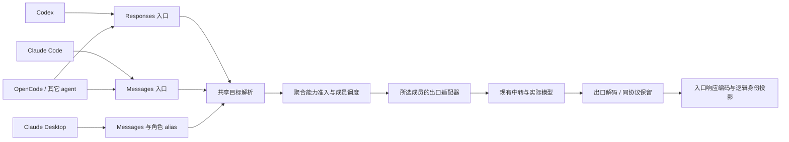

# 模型聚合与协议解耦：实施 TODO

日期：2026-10-06。状态：**基础聚合 P0–P6 已实现并完成自动化验收；P7 协议性能优化、通用 Chat 入口和真实环境验收仍待完成。**

项目基线：`main / 9e33d4e903e194bc42d2b56375ecfaa901bbccdb`。
参考源码：AxonHub `5c78997798b40e44788c38bd6720c0b9c156f26b`；CLIProxyAPI `a2976eb8a303f11b4ea5177bce9f9ff752634dfc`。

本计划接替旧“同模型渠道故障切换”的产品设计，新增独立聚合模块。保留现有供应商卡片、单渠道直连、注入保存卡与恢复事务。消费范围包括已有 Codex、Claude Code、Claude Desktop、OpenCode 注入，以及其它 agent 的标准连接导出。实施记录见 [聚合验收记录](D:/workspace/AiMaMi/docs/model-aggregation-acceptance-record.md)。勾选项表示当前源码已实现，不等同真实中转、真机或发布包已经验收；本轮测试结果单独记录，不沿用旧计划的通过状态。

## 1. 目标与首版决策

用户先选择一个官方模型，再把多个已配置中转站上的对应实际模型加入同一个聚合模型。客户端使用稳定的官方模型 ID；聚合内部选择真实渠道、实际模型与出口协议。渠道轮转无需重新写入客户端配置。

例如，两个已保存渠道分别提供 `deepseek/deepseek-v4.1-flash` 和带平台前缀的同型号。聚合公开名为目录中核对过的该型号官方 ID，成员保存各自完整 wire ID。是否把 `fast` 变体一起加入由用户显式决定，不能因基础名相似自动视为完全等价。

| 决策 | 首版规格 |
|---|---|
| 独立能力 | 新建模型聚合模块与管理入口；普通单渠道路由继续可用 |
| 旧功能 | 移除全局“同模型渠道故障切换”开关、自动同名候选和旧预算耦合 |
| 聚合身份 | 内部稳定 `aggregateId`，公开唯一 `publicModelId`，成员完整 `actualModelId` |
| 复用已有配置 | 只引用现有 provider/model；不再次填写中转地址和密钥 |
| 成员协议 | 使用渠道该模型的现有协议配置，不要求池内协议一致 |
| 调度 | 优先级分组；组内普通轮询或平滑加权轮询；临时故障冷却 |
| 聚合入口 | 新增 `/aggregate/v1`；与 `/codex/v1` 官方直通语义隔离 |
| 四类已有注入 | Codex、Claude Code、Desktop、OpenCode 共用目标解析与能力目录，各自保留现有文件事务 |
| 其它 agent | 同一版本化消费描述生成标准连接信息/配置片段；自动写入新客户端需专用 adapter |
| 本地服务 | 使用既有 listener、端口、代理设置与生命周期管理，不启动第二套网关 |
| 直连边界 | 聚合依赖本地 Router；Native/直连仍用于单渠道，不暗中改变访问模式 |
| 协议优化 | 先做行为保持的入口/出口解耦；类型化与双重 SSE 优化独立验收，不阻塞聚合基础交付 |
| 首版不纳入 | 多租户、数据库重建、OAuth 池、自动价格择优、嵌套聚合、全新搜索服务 |

“官方模型”是公开身份与用户配置的映射关系，不能据此证明上游实际运行的权重版本。现有上游声明模型对账继续保留原始观察值。

## 2. 实施前基线与本轮退役记录

### 2.1 旧功能的边界

- 旧候选要求实际模型 ID 完全相同、协议相同；不能把前缀不同的模型、不同出口协议组成一个独立模型。
- 旧重试要求稳定会话标识及安全的新请求，主要覆盖建立连接前失败和 HTTP 429；不是平时的渠道轮询。
- Desktop 曾明确跳过旧全局 failover。本轮通过 typed target 和聚合 executor 接入调度器，普通单渠道路由仍保持显式目标。
- `/codex/v1` 的裸模型 ID 走官方 OpenAI；`providerId::modelId` 才走指定中转。新聚合不能抢占原裸 ID。
- 旧 `relay_model_projection` 曾按隐式同名候选最小预算影响普通渠道目录、能力预览与压缩阈值。本轮已解除；聚合预算只由用户显式加入的成员投影产生。

| 现有位置 | 实施影响 |
|---|---|
| [router.rs](D:/workspace/AiMaMi/src-tauri/src/core/router.rs) | Store 已升级 v9；旧开关和自动候选移除，普通渠道投影与聚合目录分开 |
| [router_proxy.rs](D:/workspace/AiMaMi/src-tauri/src/core/router_proxy.rs) | 普通路由不再隐式跨卡重试；新增聚合目的地与 Desktop 聚合分支 |
| [session_affinity.rs](D:/workspace/AiMaMi/src-tauri/src/core/router_proxy/session_affinity.rs) | 从旧 `failover.rs` 保留指纹、决策锁和有界会话保护；自动同名候选已删除 |
| [newapi.rs](D:/workspace/AiMaMi/src-tauri/src/commands/newapi.rs)、[lib.rs](D:/workspace/AiMaMi/src-tauri/src/lib.rs) | 旧 Tauri 命令及注册 |
| [api.ts](D:/workspace/AiMaMi/src/lib/api.ts)、[newapi.ts](D:/workspace/AiMaMi/src/types/newapi.ts) | 旧 API、状态字段与新聚合 DTO |
| [newapi-page.tsx](D:/workspace/AiMaMi/src/components/newapi/newapi-page.tsx)、[routing-diagnostics.tsx](D:/workspace/AiMaMi/src/components/newapi/routing-diagnostics.tsx) | 移除旧开关；保留请求诊断，新增聚合选择结果 |
| [provider_model_preview.rs](D:/workspace/AiMaMi/src-tauri/src/core/provider_model_preview.rs)、[models_dev_regression_tests.rs](D:/workspace/AiMaMi/src-tauri/src/core/models_dev_regression_tests.rs) | 普通模型恢复自身预算；聚合另用显式成员投影 |
| [client_config/opencode.rs](D:/workspace/AiMaMi/src-tauri/src/core/client_config/opencode.rs)、[options.rs](D:/workspace/AiMaMi/src-tauri/src/core/client_config/options.rs) | 保留三 SDK、多 provider/模型子集、Native/Router、认证、叶子 ownership；新增聚合目标消费 |
| [frontend-regressions.tsx](D:/workspace/AiMaMi/scripts/fixtures/frontend-regressions.tsx) | 替换旧开关 mock 与断言 |

### 2.2 必须保留的既有保护

提取 endpoint/credential/model/protocol 指纹、会话首次决策锁、续接校验、有界绑定与过期处理。保留配置预览票据、外部修改冲突检测、首次接管基线、持久 journal、取消处理及真实模型落账。

OpenCode 是已经实现的注入器，不能作为尚未存在的新客户端处理。其多 provider、每 provider 模型子集、默认模型、三 SDK、用户扩展与恢复都是兼容基线；目前持久保存为 last-request/journal 与 reapply，**没有 Claude Code 式多张命名保存卡**，不能把新增能力描述成现有功能。

不再保留“关闭全局 failover 后要求重新开启”的状态语义。新聚合使用明确的目标引用、成员可用性和会话绑定原因。

## 3. 参考源码中采用与不采用的部分

| 参考 | 可采用的设计 | 本项目实施方式 |
|---|---|---|
| AxonHub [model.go](D:/workspace/temp/axonhub/llm/model.go)、[interfaces.go](D:/workspace/temp/axonhub/llm/transformer/interfaces.go) | 统一请求/响应，入口与出口独立 | 先抽接口，现有转换函数作内部实现；渐进增加中间类型 |
| AxonHub [candidates.go](D:/workspace/temp/axonhub/internal/server/orchestrator/candidates.go)、[channel.go](D:/workspace/temp/axonhub/internal/server/biz/channel.go) | 候选同时携带渠道、实际模型、优先级与出口格式 | 聚合配置只保存引用；一次选择产出完整执行计划 |
| AxonHub [outbound.go](D:/workspace/temp/axonhub/internal/server/orchestrator/outbound.go) | 每次尝试设置 `ActualModel` 并选择对应出口适配器 | 每个 attempt 从原始请求重新准备，允许成员出口协议不同 |
| AxonHub [pass_through.go](D:/workspace/temp/axonhub/internal/server/orchestrator/pass_through.go) | 同协议保留原始数据，只做所需改写 | 保留未知字段与事件；模型身份投影与供应商兼容改写显式列出 |
| AxonHub [stream.go](D:/workspace/temp/axonhub/llm/pipeline/stream.go) | 有界首段缓冲、明确响应提交边界 | 保留不重放已提交响应原则；首段缓冲单独验收，不先改变所有流 |
| CLIProxyAPI [selector.go](D:/workspace/temp/CLIProxyAPI/sdk/cliproxy/auth/selector.go) | 稳定成员 ID 轮询、平滑权重、健康会话亲和 | 内存调度，不依赖完整历史数据库；并发选择原子更新 |
| CLIProxyAPI [conductor_cooldown.go](D:/workspace/temp/CLIProxyAPI/sdk/cliproxy/auth/conductor_cooldown.go) | Retry-After、真实目标冷却与公开别名分离 | 同一实际目标经多个聚合暴露时共享冷却 |

以下行为不继承：

- AxonHub 无兼容原生工具候选时回退全部候选。本项目返回能力不满足，不能最后把请求发给明知不兼容的出口。
- 部分出口删除 custom/native tool 历史。本项目保留来源约束，无法等价表达时明确失败。
- AxonHub 为无签名 reasoning 生成随机 Anthropic thinking 签名。本项目不伪造签名，也不把普通 reasoning 冒充签名 thinking。
- CLIProxyAPI 在某些亲和目标不可用时重新选渠道。本项目有状态续接首先保障原渠道资源和私有历史，不能无条件搬迁。

参考研究针对上述 commit 的实际源码；不以参考仓库的功能介绍代替本项目验收。AxonHub 提供网关协议，并不替代本项目 Desktop 四文件注入事务。

## 4. 分层与数据契约

### 4.1 模块边界

基础交付已按下列职责拆分。协议的 typed canonical 与公共事件流属于 P7，尚未建立 `inbound/`、`outbound/` 和 `canonical.rs` 的完整实现。

```text
core/aggregation/
  types.rs          聚合模型、成员、调度与状态 DTO
  config.rs         校验、迁移、引用完整性、原子保存
  projection.rs     聚合目录、能力与容量投影
  selector.rs       优先级、轮询、权重、候选排除
  runtime.rs        冷却、并发 lease、不可变快照
  affinity.rs       会话与资源归属；独立于旧全局开关
  execution.rs      attempt 编排、重试预算、提交边界
core/model_targets.rs
                    Provider/Aggregate 引用与共享消费描述
core/model_targets_export.rs
                    版本化连接信息与 SDK 配置片段
core/router_proxy/
  aggregate.rs      聚合 HTTP 编排
  aggregate_output.rs 公开身份与资源归属投影
  forward.rs        普通/聚合共用请求准备、历史、传输与落账
core/protocol/
  types.rs          协议身份与通用错误
  adapters.rs       InboundAdapter/OutboundAdapter/WireAdapter
  原有转换模块      保持现有 JSON 与 SSE 转换实现
```

HTTP proxy 负责鉴权、方法/路径白名单、body 限制、传输与下游提交；聚合负责选成员和尝试编排；协议适配器负责表达转换。供应商的认证、endpoint 构造和已验证兼容修正与通用协议转换分开。历史、诊断、计费由请求/attempt 上下文统一驱动。



不为独立模块新增数据库或复制供应商存储。聚合类型归新模块，首版将 `aggregates` 纳入现有受保护 Store，与 providers 在同一次原子写入中维护引用。代码独立不要求配置拆成多个互相无法原子提交的文件。

### 4.2 聚合配置

下列结构对应已实现的 Rust/TS 配置契约：

```text
AggregateModel {
  id: stable UUID
  publicModelId: unique, exact official model ID
  canonicalRef: optional models.dev {providerId, modelId}
  displayName: string
  enabled: bool
  members: AggregateMember[]
  strategy: roundRobin | weightedRoundRobin
  affinity: session | statelessRotation
  retryPolicy: { maxAttempts: 2 }
  compression: inherit | existing compression policy
}
AggregateMember {
  id: stable UUID
  providerId: saved provider ID
  actualModelId: full upstream wire ID
  enabled: bool
  priority: bounded integer, smaller first
  weight: positive bounded integer
}
```

- `publicModelId` 在聚合 namespace 内唯一，创建后固定；改公开身份使用新建/迁移流程，避免保存卡悄悄失效。
- 从现有 models.dev 与已有模型目录选择官方身份。目录缺失时允许用户明确录入官方 ID，但能力/价格保持未知，不能伪装成已验证目录项。
- 前缀/后缀识别只提供关联建议。用户确认后保存完整 `actualModelId`；运行时精确查找，不再用模糊匹配猜出站模型。
- 协议、URL、推理密钥、能力覆盖和价格仍来自 provider 的实际模型配置。不能在聚合副本里另维护一份密钥。
- 拒绝同一聚合中的重复 provider/model 成员；首版不允许成员引用另一个聚合，避免循环与预算叠加。
- 建议首版限制为 128 个聚合、每聚合 64 个成员、全局 4096 条成员引用。所有相关 ID/label 均沿用现有长度与字符校验。

### 4.3 共享目标引用与导出

```text
ModelTargetRef =
  Provider  { providerId, modelId }
  Aggregate { aggregateId }

ResolvedClientTarget {
  targetRef, logicalModelId, displayName
  clientKind, ingressProtocol, endpoint
  localCredentialRef
  capabilities, contextWindow, maxOutputTokens, compression
  modelCatalogProjection, availability, reason
  fileProjectionRevision, routeRevision, catalogRevision
}

SelectedAttempt {
  aggregateId, memberId, publicModelId
  providerId, actualModelId
  configuredProtocol, effectiveProtocol
  endpoint/auth snapshot, compatibilityPlan
  price snapshot, catalogRevision, routeRevision
}
```

共享 resolver 输出受保护 credential 引用；UI/预览 DTO 不携带真实密钥。注入器只在写受保护客户端配置时读取本地 token。上游鉴权由实际 provider 决定，本地 token 绝不转发上游。

保存卡只保存目标引用、角色映射与用户选项。不保存“这次轮询选中 A 渠道”、派生 endpoint 或实际成员密钥。一键应用时重新解析；成员轮转不会让保存卡变成另一个目标。

多模型消费者不能缩成一个 `targetRef`。另用 `ClientModelSelection { defaultTarget, availableTargets[] }` 表达 OpenCode 的多 provider/模型子集和聚合列表，兼容原 `providerIds/providerModelIds`。同一连接描述按目标客户端格式投影，不把成员出口协议当作客户端入口协议。

### 4.4 面向其它 agent 的版本化消费产物

```text
AgentConnectionExport {
  schemaVersion, consumerProfile
  ingressProtocol, baseUrl, requestPath
  modelsPath, modelsFormat
  selectedModelId
  modelCatalog[{ targetRef, publicModelId, label, capabilities, limits }]
  authScheme, localCredentialRef
  listenerReady, runtimeRequirement
  configRevision, catalogRevision, tokenVersion
}
```

受管注入与通用导出都消费同一描述。首版提供通用连接信息、Responses/Messages 配置片段及 OpenCode 配置片段；普通预览脱敏，实际复制配置时按明确操作解析本地 token，不导出上游钥匙。未知 agent 只导出连接信息，不猜其配置路径或改用户文件。

`consumerProfile` 声明接受的入口协议、模型目录格式和必须能力；只导出当前已实现并通过验收的组合。支持 Responses 或 Messages 的 agent 可直接使用聚合 endpoint/public ID；只支持 Chat 的 agent 在完成 Chat 入口扩展前不宣称能消费任意混合池。增加自动注入新 agent 只新增配置 adapter 与 ownership/恢复，不能把客户端特例塞进调度器。

`modelsFormat` 明示 Codex/OpenAI 模型列表与内部通用 catalog 的区别。需要 Anthropic HTTP 模型发现的客户端必须使用明确的 Anthropic 投影入口；不能给它一个 OpenAI 列表并称“协议兼容”。模板只生成可消费的字段，不把通用 JSON 当作所有 agent 的原生配置。

URL 也按 consumerProfile 导出：Anthropic SDK 可能自动追加 `/v1/messages`，OpenCode AI SDK 的 baseURL 已含 `/v1`；不能把同一个字符串机械写给两种 SDK 导致重复 `/v1`。导出需给出最终请求路径与目录格式，供 adapter 验证实际出站。

### 4.5 修订与配置变化

| 变化 | 处理 |
|---|---|
| 余额、价格、展示名称刷新 | 不使原渠道会话失效；需要时更新目录/文件投影 |
| 权重、优先级、增加成员 | 后续新选择用新调度配置；健康已有绑定保持 |
| 实际成员被删除/禁用/模型被排除 | 新请求不选该成员；原成员续接明确 unavailable，不随机换目标 |
| URL、推理密钥、配置协议或允许的兼容计划版本变化 | 连接身份变化，旧有状态续接拒绝误投；聚合更新运行时，实际导出内容变化才提示文件 stale |
| 角色重新映射/删除聚合 | 被引用的保存卡与已应用配置显示不可用；保留恢复入口 |
| 程序重启 | 重新加载配置并启动必要 listener；内存资源归属不能伪装成仍存在 |

不能直接拿当前 `router::config_revision` 的整个 Store hash 作为会话 key：余额/`updated_at` 等无关变化也会使它变动。分离拓扑修订、具体连接身份和客户端文件投影修订；修改权重不应作废整个对话。

聚合注入只写本地地址、local token、公开模型与能力投影。仅成员轮转、权重或上游换钥无需重新注入；profile/catalog/本地 token/目标引用等实际受管文件投影变化才需要重新应用。单渠道直连写入上游凭据时，仍遵守其既有 stale/reapply 规则。

一次请求冻结 provider/aggregate/catalog 快照，各 attempt 使用同一代。保存后原子发布新快照；已发出的上游请求允许自然完成，尚未发出的重试成员若已被禁用、删除或凭据撤销则取消该尝试，不能继续用旧密钥作“last-good”。重试前的最新撤销检查只负责禁止发送，不从新配置补入 URL/key/model 混合两代快照。

## 5. 聚合 HTTP 与注入消费

### 5.1 入口与模型身份

| 入口 | 计划行为与发布边界 |
|---|---|
| `POST /aggregate/v1/responses` | Codex/Responses 入口，精确 public ID → aggregate → member |
| `POST /aggregate/v1/messages` | Claude Code/Messages 入口，精确 public ID → aggregate → member |
| `POST /aggregate/v1/chat/completions` | 独立扩展阶段新增；实现 Chat 解码与缺失转换方向后才能导出通用 Chat 模板 |
| `GET /aggregate/v1/models` | OpenAI 目录投影，只公开聚合 public IDs；显式 `?format=anthropic` 返回 Anthropic 目录投影 |
| `/aggregate/v1/responses/{id}` 及 cancel/input_items | 原资源索引指向原成员；不根据默认模型重选 |
| `/aggregate/v1/responses/compact` | 仅原生 Responses 成员可接收；无 previous resource 的独立 compact 可选原生成员，带资源则保留原归属；跨协议不伪造 compact |
| `/aggregate/v1/messages/count_tokens` | 仅原生 Messages 成员可接收；计数不建立推理会话绑定，无兼容成员时明确拒绝 |
| `/claude-desktop/v1/messages`、`/models` | 保持 Desktop 专用鉴权与安全角色 alias，内部 target 可引用聚合 |

沿用现有 endpoint 白名单，不代理供应商管理、充值、任意文件接口。未知 public ID、未配置 alias、无可用成员分别返回结构化错误；不落到 active provider 或官方账户。

Codex 与 Claude Code 共用 `/aggregate` namespace，但不让 GET `/models` 猜返回协议。Claude Code 的 picker 从内部共享目录写入；Desktop 的 `/models` 继续 Anthropic alias schema。通用 Anthropic SDK 导出使用明确的 `?format=anthropic` 模型发现地址。

基础交付保留现有转换范围：Responses/Messages 两种聚合入口、Responses/Chat/Messages 三种出口。已有普通单渠道 Chat 入口与 Chat→Chat 原生直通继续保留。通用 Chat 聚合入口与 **Chat→Responses/Messages** 是独立增量，按 P7 的扩展任务实现后发布，不算当前代码已经支持。

当前矩阵必须在目录/导出/运行时一致表达：

| 客户端入口 → 上游出口 | Responses | Chat Completions | Messages |
|---|---|---|---|
| Responses | 原生 | 已有转换 | 已有转换 |
| Messages | 已有转换 | 已有转换 | 原生 |
| Chat Completions | 待新增 | 原生 | 待新增 |

OpenCode 使用 Responses 或 Messages 的固定入口即可消费混合池，无需先补两个新方向。只有 Chat 模板需要扩展完成；不能将“三出口”写成“已有任意双向互转”。

聚合 Responses/Messages 响应中协议定义的 `model` 字段投影为公开逻辑 ID；观察真实上游 model 后再投影，不替换任意文本/工具结果中的字符串，不凭空添加上游没返回的字段。Desktop 聚合响应同样使用 `publicModelId`；普通 Desktop 单渠道响应继续使用角色 alias。诊断保留请求 alias、实际上游 ID 与原始声明值。

### 5.2 Codex

- 新增独立受管 provider key，例如 `agentharbor_aggregate`，`wire_api = responses`，base URL 指向 `/aggregate/v1`。
- `model` 与完整 Codex catalog 使用 public ID；必填能力字段、instructions、context/output/compression 由共享投影生成。
- `/codex/v1` 中官方裸 ID 和 `providerId::modelId` 原语义保持。首版聚合使用独立目录/配置，不强塞进旧混合 picker。
- 登录与免登录两条认证路径复用现有契约：`requires_openai_auth = !accountless`，本地认证使用受管专用 header，免登录时才额外写 `experimental_bearer_token`。登录凭据/local token 的 snapshot 与恢复继续独立维护；两种模式的中转出站都使用实际成员凭据。
- 聚合一键应用属于本地 Router 配置；Native 表单不接受 Aggregate，也不在后台改用户模式。
- 复用 [router_config_snapshot.rs](D:/workspace/AiMaMi/src-tauri/src/core/router_config_snapshot.rs) 的受管字段、首次基线、journal、备份、外部修改和恢复机制；扩展 ownership 对新 provider key 的识别。

### 5.3 Claude Code

- 向后兼容升级 `ConfigRequest` 和保存卡：旧 `providerId/model` 可读为 Provider，新配置写 typed target。
- `ANTHROPIC_BASE_URL` 使用本地 `/aggregate`；主模型与各角色可引用不同聚合 public ID。
- startup、sonnet、opus、fable、haiku、subagent，以及 modelPicker/availableModels 均从同一目录解析，不能遗留实际成员 wire ID。
- 保留 AUTH_TOKEN/API_KEY 二选一、云厂商 selector 冲突检查、预览/revision、保存、一键应用、reapply、restore/release。
- 聚合 Claude Code `[1m]` 与 Desktop 使用相同的真实容量准入，可选择 Messages/Responses/Chat 三出口中有据 context≥1M 且能表达请求的成员。marker 不发给上游，仅 Messages 出口添加对应 beta；Chat/Responses 不编造 1M 参数。直连客户端注入仍沿用原模式约束，百万 token 真机验收保留待办。

### 5.4 Claude Desktop

- `DesktopRouteChoice` 与保存卡增加 `targetRef`，兼容原 provider/model；角色可选择单渠道或聚合。
- profile 保持经 Desktop 版本策略校验的 sonnet/opus/haiku/fable 安全 alias；不直接写任意聚合名称作为 Desktop 模型名。
- gateway 从 alias 取得目标引用，再进入同一个聚合 selector/executor；Desktop 不再仅有固定 provider 分支。
- `supports1m`、label 与可用性来自共享目标投影。保留当前 **Messages/Responses/Chat 三出口的 Desktop 1M 支持**。
- 用户勾选 1M 的请求只选择有可信 context≥1M 且能表达本次请求的成员。Messages 添加对应 beta；Chat/Responses 不转发 Claude beta，也不编造 1M 参数。
- 保留当前可直接点击的 1M 复选框与用户选择，不新增重复解释文字；profile 每角色仍仅写一条，Desktop 是否生成普通/1M 两项沿用其外部契约。
- 保留专用 gateway token、listener lease、preview ticket、四文件事务、journal、首次接管基线、停止/写入/重启顺序。查看预览不能新增停止进程要求。
- 空档位不自动猜模型。可在配置提交位置简短列出未配置角色；运行时缺失 alias 给明确错误。

### 5.5 OpenCode：接入已有注入器

复用 [opencode.rs](D:/workspace/AiMaMi/src-tauri/src/core/client_config/opencode.rs) 的适配器与 ConfigManager，不另写一套注入/恢复系统：

- 保留原多 provider、各自模型子集、默认模型与三协议分组；聚合是新增目标来源，不能把原 `providerIds/providerModelIds` 缩成单模型请求。
- 增加稳定入口组，例如 `agentharbor_aggregate_responses`，baseURL `/aggregate/v1`，npm 使用现有 Responses 路径 `@ai-sdk/openai`。model 键为 public ID，默认模型为 `group/publicModelId`，保留 ID 中的 `/`，不错误拆成另一 provider。
- 必要时提供显式 Messages 入口组，SDK 用 `@ai-sdk/anthropic`。SDK/npm 由固定入口决定，不能随轮转成员的出口改变；两个入口组分别声明能力。
- 原单渠道 Chat 继续 `@ai-sdk/openai-compatible`。混合池的通用 Chat 分组在对应入口/转换验收前不生成。
- model name/context/output 由共享投影导出；现有用户显式限制继续尊重，但不能突破聚合可兑现预算。轮转不重写 npm、baseURL、models 或默认模型。
- 保留 Native 各自根路径、Anthropic Bearer/API key 排他、冲突认证头处理、JSONC/JSON5 读取、已存在的官方 provider、headers、variants、custom models、enabled/disabled providers。
- 复用叶子 ownership、preview/revision、journal、原子 apply、reapply、restore/rebaseline/release；旧 `opencode.dat` 与 TS 请求可迁移读取。
- 保持现有持久保存/重新应用入口；如果另做命名保存卡，作为 UI 增量而非聚合使用前提。

Context7 于 2026-10-06 核对的 [OpenCode 官方自定义 provider 文档](https://github.com/anomalyco/opencode/blob/dev/packages/web/src/content/docs/providers.mdx) 和 [native-request 实现](https://github.com/anomalyco/opencode/blob/dev/packages/opencode/src/session/llm/native-request.ts)确认 `npm/options.baseURL/apiKey/models/limit` 的消费方式，以及 OpenAI Responses 与 openai-compatible 的区别。这是当前文档证据，客户端版本变化仍由 adapter 验收，不替代本项目现有回归。

### 5.6 listener、外部消费者与认证

聚合使用现有受保护 Router token 和 loopback listener；Desktop token 仍只授权 `/claude-desktop`，不能拿它调用通用聚合/旧路由 endpoint。需要兼容的本地认证头由入口显式处理，不混入上游头。

`routing_runtime::needs_server` 计入已经应用的聚合消费者，包括 OpenCode。仅保存但未应用的配置不强制常驻服务；应用/预览所需的 listener 使用现有 reservation。关闭 Codex、切 Native、恢复另一客户端不能停止仍被其它已应用客户端使用的 listener。端口占用、启动恢复、退出恢复与 token 轮换沿用既有安全处置。

其它 agent 复制配置后没有本项目注入 journal，需增加独立“保持聚合服务运行”的持久运行需求，默认关闭，用户启用后计入 `needs_server`，不依赖 Codex 或任一受管注入开关。它管理服务生命周期，不作为新的鉴权权限。仅导出草稿不会自动常驻；实际接入操作可启动服务并返回 listener 状态。手工配置不由退出恢复自动改写；本进程退出后 endpoint 不可用，token 轮换后支持重新导出。继续 loopback 绑定，不引入外网监听。

## 6. 候选、轮转与重试

### 6.1 候选准入与能力

先处理请求能力与供应商兼容计划，再调度。准入至少包含：provider/member 启用、推理密钥存在、actual model 可路由、有效 endpoint、入口到出口转换支持、context/output、图片、普通/自定义/namespace 工具、推理私有字段、流式、1M、搜索、compact/资源操作。

支持状态区分 supported/unsupported/unknown，并保留依据。未知能力不是已确认支持；对必须保证的能力与有来源限制的状态请求不放宽为随机候选。普通文本可继续沿用现有保守预算，但目录需标明 fallback 来源。

当前 Command 搜索兼容会把某些 Messages→Responses 请求改用已确认存在的 Chat endpoint。重构时将它移到显式 `compatibilityPlan`：保留 configured/effective protocol、触发条件和诊断，先计算实际出口再判断成员准入、冷却和价格，不在选择完后偷偷改变协议。

搜索执行能力与模型协议独立：原生 hosted search、既有本地搜索执行器、不可用三种情况分别投影，并按 **入口协议×有效出口×执行计划** 准入。当前本地搜索执行器只处理 Messages→Chat；不能因有搜索账号就宣称 OpenCode Responses→Chat 或新的 Chat 入口已支持 hosted search。复用现有账号/搜索凭据，聚合不新增一份搜索密钥；不因模型 ID 含 `claude` 或协议叫 Responses 就承诺 WebSearch。工具 schema、累计预算、返回引用与历史回放继续按现有语义校验；新增入口的搜索执行需要独立适配和验收。

### 6.2 轮转规格

1. 先解析必须沿用的资源/会话归属；合法绑定优先，不能被轮询覆盖。
2. 新选择过滤不可用、冷却、不满足能力、并发已满以及当前请求已试成员。
3. 选择数字最小且有可用候选的优先级组。高优先级恢复只影响新选择，不抢走健康已绑定对话。
4. `roundRobin` 按稳定成员 ID 和上次选中位置推进；能力过滤/临时冷却改变集合时不能每次归零。
5. `weightedRoundRobin` 保留平滑权重累计；权重 3:1 表示长期选择比例，不表示单请求重发三次。
6. 选择、游标/权重更新、并发 reservation 在同一短临界区完成。网络请求与 SSE 不持全局调度锁。
7. 每个 attempt 持有并发 lease；失败、取消、客户端断开和流终止均释放。同会话首次决策锁不串行等待整个响应流。建议首版固定全局 128、每真实目标 16 个在途 attempt；重复卡片/不同聚合共享真实目标计数，内部搜索轮次沿用该 attempt 的 lease，不递归占用。P0 锁定这些默认值与容量错误契约，不必增加 UI 配置项。

默认 `affinity=session`：有稳定会话标识时保持健康成员，新会话参与轮转；无会话标识的独立完整请求也能轮转，不沿用旧功能“无 session 不启用”的限制。`statelessRotation` 仅对已证明可移植的完整请求按请求轮转；有状态归属仍强制绑定。

### 6.3 续接与历史

亲和 scope 包含 app/store、可验证的客户端/配置身份、聚合 ID、逻辑模型及会话标识；只有 Desktop alias 或已验证显式字段提供角色时才加入 role。Claude Code 两个角色使用同一 public ID、同一 session 且没有角色字段时，共用该逻辑目标的绑定，不从模型名/提示词推测角色。不可识别的配置使用明确的通用入口 scope，不承诺无法观察的隔离。

绑定保存 member/provider/actual model 与稳定连接身份，另记录资源/private history 的实际出口归属。请求级 compatibilityPlan 与配置身份变化分开：已验证的 Command 普通→search→history-only 可以保持同一成员而切换请求出口，不仅因 effectiveProtocol 不同作废；原生 response ID、private reasoning 等端点专属状态仍固定原出口，不能等价恢复时拒绝。

- 原生 `previous_response_id`、后台任务、retrieve/delete/cancel/input_items 必须回原成员。建立有界资源 ID→真实成员索引，无模型 body 的操作不能使用默认模型选路。同 scope 若出现相同外部 ID 指向不同归属，不能覆盖旧索引；标记冲突并拒绝歧义访问，不能随机选一个渠道。
- 本地转换产生的 response ID 归本地历史，不与原生资源 ID 混用。只有可完整恢复历史且目标可表达时才允许本地续接。
- 工具上下文未闭合、thinking signature、加密/private reasoning、供应商私有历史不无条件迁移。unknown/过期/删除/身份变化时返回明确归属错误。
- 首版绑定与资源索引保留在内存，不持久化对话正文。程序重启后未知上游资源明确报错，不重新轮询。以后若要跨重启恢复，另设计受保护的最小归属持久化。
- 参数/转换预检失败不能破坏已存在绑定。首次会话选择在转发前 reservation，初始路由确认成功后 commit；connect/429 备用仍属 pending，失败候选不发布。同会话决策锁保持至 commit 或明确失败，其它同会话请求不能在 pending 时另选成员，但不等整条 SSE 结束才释放。
- 原生资源索引单独在观察到实际 resource ID 后提交；首次向客户端暴露该 ID 前必须建立索引，尚未完成的资源也有明确归属。可能产生原生资源的 create 在出站前预留容量，失败且未产生资源时释放 reservation。

### 6.4 默认失败策略

| 场景 | 首版处理 |
|---|---|
| 明确的建立连接前失败 | 新且可安全重放、未提交下游响应时最多一个备用 attempt |
| HTTP 429 | 同样边界下换另一候选，尊重 Retry-After；默认不在同成员立即重发 |
| 本地能力/格式/协议校验失败 | 不发送该候选；确定的调用者错误直接失败，不假装渠道故障 |
| 400/401/403/404 等 | 不盲目换渠道重放；保留错误类别，凭据拒绝可使该连接身份进入不可用状态 |
| 请求超时、连接建立后断开、普通 5xx | 首版不自动重放，不能证明上游未执行 |
| 已提交 HTTP 响应头、keepalive 或内容 | 不切成员继续写流；按当前入口协议报告终止/截断 |
| 已执行 hosted search/工具副作用、私有历史续轮 | 不重放整次流程；使用现有执行器的局部安全规则 |
| 取消或 deadline 到期 | 停止剩余尝试、释放 lease，不再启动下一候选 |
| 全部冷却/不满足能力 | 立即返回具体不可用原因和适用 Retry-After，不阻塞等待整个冷却期 |

`maxAttempts=2` 包含首尝试，总 deadline 沿用传输限制，不能为每个备用重置一遍。尝试去重以真实连接/model/effective protocol 身份为准，防止重复 provider 卡片指向同一目标时形成回环。

冷却共享真实目标身份，不按 public alias 分开制造多个独立额度。支持 Retry-After 时间/秒数、合理上限与退避；状态恢复通过到期后的受限试探，不用无限后台探测。

## 7. 能力、压缩、费用与诊断

### 7.1 聚合能力不取成员最大值

普通目录 context/output 对配置启用且可路由的成员取可兑现的保守下限，临时冷却不使菜单容量反复跳动。未知成员容量使用现有安全 fallback 并保留来源；无法兑现特殊能力的成员在对应请求中排除。

公开默认能力分为“所有普通候选都支持”与“存在可筛选的能力候选”。例如 128K+1M 成员的普通目录不能宣称无条件 1M；Desktop 勾选 1M 后形成明确的 1M 候选子集。成员配置/能力下降时，旧选择不再满足就拒绝，不能以旧菜单声明放行小窗口。

复用现有 model policy/resolver；聚合可用已有压缩策略覆盖，未设则继承全局。删除旧普通渠道的隐式跨渠道最小预算；注入导出、能力预览、运行时准入使用同一聚合投影。热路径使用已加载的 catalog Arc，不下载/重解析整个 models.dev。

### 7.2 实际成员落账

- 按 `actualModelId` 和实际 provider 的价格覆盖、目录绑定、价格快照落账，不拿 public ID 或 Desktop alias 查价。
- 一次客户端请求共享 `requestId`，每个 attempt 独立 `attemptId`、价格快照、目录修订、协议和上游观察；切成员后不得沿用首成员价格。
- 失败、截断、取消可能已经有用量，按既有覆盖状态记录；未知费用不显示零费用，不重复落账。
- 保留缓存读/写拆分、零价与用户价格覆盖。聚合页面可以展示价格范围及来源，不把各渠道价格相加或伪造一个统一单价。

### 7.3 请求诊断与状态上限

诊断至少贯通：client source、requested public/role alias、aggregate/member ID、resolved actual model、原始 served model、configured/effective protocol、route/catalog revision、选择/排除理由、亲和命中、冷却、retry reason、attempt ID。

新诊断使用一般 `retry_reason`。请求诊断只存内存，无旧诊断文件需要迁移；历史 Store 的旧 failover 设置读入后弃用，不再序列化。未真正出站的候选只列为跳过理由，不制造虚假 attempt；跳过摘要有数量与文本上限，不记录正文、完整 headers、URL 或上游原始错误全文。

首版边界：聚合配置 128/64/4096 引用上限；亲和和资源归属分别设置条目/字节上限与 idle TTL，可从现有 1024/24h 绑定标准起步。已有活跃绑定不因容量满随机驱逐；需要会话亲和或可能产生原生资源归属的新请求在转发前预留容量，容量不足则拒绝。只有明确不依赖后续归属的独立请求可以绕过绑定容量，不能因 create 尚无 previous_response_id 就让它绕过资源索引上限。

保留现有 Responses 历史 512 项/16 MiB 与 Messages 历史 512 项/16 MiB/1h 约束；scope 扩展不能把上限变成“每个聚合另建一套”。保留诊断最近 60 请求，额外限制每请求 attempt/跳过摘要。首段缓冲若实施，必须另有事件数、字节与等待时限；不把完整 SSE 常驻内存。禁用/删除目标后的冷却、cursor 和闲置锁均有清理路径。

## 8. 协议优化的渐进实施

### 8.1 先明确边界，复用现有正确行为

将 `ModelProtocol` 归协议层，router 临时 re-export 以减少一次性改动。定义 `InboundAdapter`、`OutboundAdapter`、`PreparedRequest`、`AttemptContext`、`ProtocolError`；原 `Translation`/request_body/response_body 函数先在内部工作。

协议模块不读取聚合配置、不决定轮转、不写健康状态；聚合 executor 不拼工具 JSON、不解析 SSE。请求上下文保存原始 bytes、一次规范化结果、客户端 scope、能力要求与总 deadline；attempt 上下文保存成员快照、适配器状态、价格、观察、提交状态。共享规范化只含客户端携带的可移植语义；成员私有历史恢复、兼容修正和出口编码均在 attempt 内按匹配来源执行，不能把 A 恢复出的私有字段当作 B 的编码输入。

### 8.2 两种执行路径

- 同协议：保留原始请求/响应/事件；只改实际 model、逻辑 model 投影、必要头和已验证供应商兼容字段。
- 跨协议：入口解码 → 中间请求 → 当前成员出口编码；响应/事件由出口解码 → 入口编码。每次尝试建立独立适配器状态。

现有 Responses JSON 已承担部分中间表示，先用它兼容历史，再逐步类型化。最小中间表示覆盖消息顺序、文本/图片、function call/result、usage、完成/失败/不完整状态；reasoning、cache、工具 namespace、搜索引用、签名/加密字段作为带来源的扩展。

同协议未知字段与未知事件不因规范化丢失；跨协议无法表达的必需字段明确失败。不能为“兼容”伪造签名或悄悄删工具历史。模型名不参与入口协议推断，路径决定入口，成员有效执行计划决定出口。

### 8.3 消除重复事件转换

当前 Messages←Chat SSE 经 Chat→Responses SSE→Messages SSE 两次编码/解析。先抽统一内部事件，让 Chat decoder 直接供 Messages encoder 使用；保留原生透传。

使用同一事件终态驱动诊断、历史和用量，但区分“收到协议终止”“可恢复的完整历史”“正常 incomplete”“真正失败”。incomplete 不被默认标成上游失败，缺终止 EOF 不写入成功历史。

首段缓冲只用于明确可重试、尚未提交下游的新请求；缓冲上限耗尽/等待到期按终止策略结束，不在输出内容后继续切渠道。keepalive 一旦写出也属于下游已提交，重试状态机必须认识这一点。

性能比较使用同一组大历史、流分帧与工具 fixtures，记录转换次数、分配/峰值内存、首 token 延迟；先建立测量基线，不宣称固定倍数提升。

### 8.4 既有功能不回退的发布门槛

协议改造不是重新定义已实现行为。每个接口抽取、事件优化或新增方向分别提交，固定同一组 fixtures，比较旧/新请求 body、响应、事件序列、工具 ID 关联、历史与费用。只归一化随机 ID/时间等非语义值，不删掉旧断言来“适配”回退。

| 既有能力 | 每次相关重构必须保留 |
|---|---|
| 三条原生路径 | 未知 JSON 字段/SSE 事件、reasoning/cache/custom tool；除显式 model/兼容 patch 外保持内容 |
| 四条已有跨协议路径 | 非流/流、多轮、并行工具、tool-only turn、图片、交错 reasoning；非法/孤立/重复工具历史仍明确拒绝 |
| WebSearch | 原生/转换/local executor 各自边界，强制 tool choice、自定义名称、max uses、域名、引用与 history-only |
| Desktop 1M | 三出口×流/非流×开关×多轮工具；marker 不出站，仅 Messages beta，预算与用户选择保持 |
| 终态与续接 | completed/incomplete/failed/截断/静默超时/取消准确；仅合法完成写历史；原资源回原成员 |
| 已有注入 | 四客户端单渠道、官方、Native/Router、登录、保存/reapply、所有权、冲突、备份与恢复 |
| OpenCode 特有行为 | 多 provider/子集、三 SDK 根路径、Bearer/API key 排他、headers/variants/custom models 与撤回旧分组 |

参考回归入口：[client_config/tests.rs](D:/workspace/AiMaMi/src-tauri/src/core/client_config/tests.rs)、[native_tests.rs](D:/workspace/AiMaMi/src-tauri/src/core/client_config/native_tests.rs)、[ownership_tests.rs](D:/workspace/AiMaMi/src-tauri/src/core/client_config/ownership_tests.rs)、[hosted_search_tests.rs](D:/workspace/AiMaMi/src-tauri/src/core/router_proxy/hosted_search_tests.rs)、[desktop_gateway_tests.rs](D:/workspace/AiMaMi/src-tauri/src/core/router_proxy/desktop_gateway_tests.rs)。新增聚合测试补在这些基线之外，不能用少量新 mock 替代原覆盖。

### 8.5 通用 Chat 入口是独立新增功能

只支持 Chat Completions 的 agent 消费完整混合池，需要新增 `/aggregate/v1/chat/completions`、Chat 请求解码和 Chat 响应编码，以及 Chat→Responses/Messages 两方向。可先复用共享适配器/可移植中间请求，后续再一起类型化；不能先给 UI 配置一个 Chat SDK 就算完成。

完成前不导出“完整混合池 Chat 模板”；若提供 Chat→Chat 子集，目录/能力必须标明其候选范围，不能把被排除的 Responses/Messages 成员算入轮转。完成后仍按具体工具/状态/搜索能力筛选，不能宣称所有私有能力在九条路径都等价。

基础聚合可以先交付，协议性能优化与 Chat 扩展分别通过上述门槛再发布。新入口的搜索执行、模型发现和客户端模板各自验证；不将普通工具可转换误报为所有 hosted tool 都可用。

## 9. 按依赖实施 TODO

`[x]` 表示源码已实现并有对应隔离回归入口；`[ ]` 表示待实施或交付验收尚未收尾。P0–P6 的源码/测试路径和执行证据见 [聚合验收记录](D:/workspace/AiMaMi/docs/model-aggregation-acceptance-record.md)。P8.1 的串行 Rust、Desktop/local/aggregate targeted、前端、构建和 `git diff --check` 已有结果；mock 覆盖不替代 P8.2/P8.3 的真实环境验证。

### P0｜冻结契约与回归基线

- [x] P0.1 固定 public/aggregate/member/actual 四种身份、唯一性、目录来源、显式映射与全局/真实目标并发默认上限。
- [x] P0.2 固定 `/aggregate` 基础两入口/三出口、Chat 增量边界、官方直通语义、四种已有注入与通用 export 契约。
- [x] P0.3 给现有原生/跨协议、搜索、工具历史、1M、恢复与费用 fixtures 建立可对比基线。
- [x] P0.4 记录旧 failover 开关/命令/预算/绑定/测试的完整引用清单，保留迁移前配置样本。

完成条件：可以从“公开模型→成员→出口→客户端”追踪一条执行链；数据、迁移和错误契约无未决定分支。

### P1｜协议与目标接口抽取，保持行为

- [x] P1.1 协议类型移到 protocol 层，router 临时导出兼容；避免 aggregation 依赖 router 的协议实现细节。
- [x] P1.2 抽入/出口适配器与结构化错误，原转换函数作内部实现；保持现有支持矩阵。
- [x] P1.3 收拢请求/attempt 上下文，传输、历史、诊断、费用不再各自重算模型与协议。
- [x] P1.4 建立 typed `ModelTargetRef`、多模型 selection 与共享 resolver；先支持 Provider 路径，证明四种已有注入无行为变化。
- [x] P1.5 提取旧绑定的指纹/锁/有界清理保护，不带旧全局开关语义。

完成条件：现有单渠道、Native、Desktop 三协议 1M、搜索与恢复回归通过；尚不改变公开路由行为。

### P2｜聚合配置、迁移与共享目录

- [x] P2.1 新增聚合/member 类型与 serde/TS DTO，纳入现有 Store 原子保存；Store v8 已迁移到 v9。
- [x] P2.2 legacy failover 字段读入后丢弃并停止序列化；迁移保存首次受保护原文件，不根据旧开关自动创建池。
- [x] P2.3 校验 ID、重复成员、权重/优先级、数量上限与 Provider/model 引用；定义失效原因码。
- [x] P2.4 实现 provider/member/aggregate 删除、禁用和模型排除的引用投影；保留旧保存卡可读和恢复。
- [x] P2.5 实现容量、输出、工具/搜索/1M、压缩投影，与模型能力预览共享 resolver。
- [x] P2.6 发布不可变路由/catalog 快照；区分拓扑、连接身份和文件投影修订。

完成条件：已有 provider 不需重新输入凭据；配置坏项不被静默删除；保存失败不发布半套新状态。

### P3｜独立调度与归属

- [x] P3.1 实现请求能力提取、已验证 compatibility plan 和候选预检，先资格过滤再轮询。
- [x] P3.2 实现优先级、稳定 ID round-robin、smooth weighted round-robin，暂时过滤不重置计数。
- [x] P3.3 实现原子选择/并发 lease、取消释放、Retry-After 冷却和有界状态清理。
- [x] P3.4 实现客户端/config/aggregate/role/session scope，健康绑定优先与无 session 新请求轮转。
- [x] P3.5 实现原生 response/resource 归属索引及本地历史隔离；重启/过期/身份改变明确报错。
- [x] P3.6 实现尝试去重、maxAttempts、总 deadline、错误分类与响应提交状态。

完成条件：调度器可用固定时钟与 fake members 单独验证，不依赖真实网络和任何注入器。

### P4｜聚合传输、诊断与费用

- [x] P4.1 新增 `/aggregate` 路径解析/认证/方法白名单和目录；unknown public ID 不走 fallback。
- [x] P4.2 聚合模型选到成员后逐 attempt 重新准备出口；不同协议成员可共池并返回同一入口格式。
- [x] P4.3 接入有限连接失败/429 备用；禁止输出后、续接、超时及副作用后的整请求重放。
- [x] P4.4 先观察上游身份，再做聚合逻辑 model 投影；保留真实 served model 诊断。
- [x] P4.5 按实际成员/模型快照落账，贯通 request/attempt ID；skip 不伪装出站。
- [x] P4.6 接入共享 runtime，纳入 OpenCode 与独立外部使用需求；关闭一个消费者不终止其它消费者，端口冲突保持恢复。

完成条件：mock 端到端可证明公开 ID、实际上游 body、协议、尝试次数与价格来源一致。

### P5｜四种已有注入与通用导出

- [x] P5.1 Codex 新 provider key/catalog、选模型、登录/免登录认证、预览、一键应用、reapply、ownership 和恢复。
- [x] P5.2 Claude Code typed 配置迁移，主模型/角色/public ID/picker 与保存卡一键应用。
- [x] P5.3 Desktop targetRef 保存迁移、alias→聚合执行、专用 token 与四文件事务。
- [x] P5.4 各消费方从同一投影获取容量/压缩/1M；Desktop 保持三协议 1M 和单次点击复选框。
- [x] P5.5 测试 stale ticket、provider/key/role 变化、外部改动、失败回滚与首次还原点。
- [x] P5.6 处理部分角色未配置、目标不可用和删除引用；提供必要操作入口，不增加常驻说明墙。
- [x] P5.7 OpenCode 多目标选择/聚合入口组/limits/default model 迁移，保留原三 SDK、Native/Router、多 provider/子集。
- [x] P5.8 OpenCode 原 journal/JSONC/ownership/reapply/restore 回归，保留用户 headers/variants/custom models 和已有 provider。
- [x] P5.9 实现版本化 AgentConnectionExport，生成连接信息/Responses/Messages/OpenCode 模板；只导出已验收入口。
- [x] P5.10 实现外部 agent 的保持服务运行/就绪状态/token 重新导出；没有已知 adapter 不自动改其文件。

完成条件：聚合保存一次，四种客户端均可预览/应用/reapply；通用产物能配置已支持标准协议的其它 agent。普通轮转不改客户端文件，不产生重复 profile 行；OpenCode 既有多模型选择未缩水。

### P6｜聚合 UI 与旧功能退役

- [x] P6.1 增加独立“模型聚合”管理入口：官方模型、成员、实际型号/协议、权重/优先级、状态。
- [x] P6.2 复用已有中转模型选择和模型匹配预览，关联建议经用户确认后存完整 wire ID。
- [x] P6.3 在注入选择器提供单渠道/聚合目标；目录状态与保存卡状态来自共享 DTO。
- [x] P6.4 移除 old failover toggle/API/Tauri 命令/View/i18n/fixture，启用 legacy 字段最终移除迁移；普通渠道预算不受其它卡片影响。
- [x] P6.5 替换旧候选、seen/开关续接逻辑；通用 affinity 和历史安全测试继续保留。
- [x] P6.6 更新旧功能文档、models-dev 预算描述与 Desktop 路由说明，注明本新计划接替的规则。

完成条件：正式入口只暴露显式聚合，不再存在两套跨渠道选路；仅兼容读取/历史解码保留 legacy 字段名。

### P7｜可独立发布的协议优化与通用 Chat 扩展

- [ ] P7.1 逐步引入消息/工具/usage/终态类型及带来源 extensions，兼容现有历史条目。
- [ ] P7.2 Chat decoder → 公共事件 → Messages encoder，移除中间 Responses SSE 编码再解析。
- [ ] P7.3 统一终态供历史、诊断和用量消费；保留 incomplete 与 truncated 的区别。
- [ ] P7.4 差分验证同协议未知字段/事件与必要 model patch；验证私有扩展不能越协议回放。
- [ ] P7.5 建立分帧/工具/大历史性能基线，验证避免重复整段请求解析且内存有界。
- [ ] P7.6 若启用首段缓冲，独立验证事件/字节/等待上限与 headers/keepalive 提交边界；失败尝试不泄漏事件。
- [ ] P7.7 新增通用 Chat 聚合入口与 Chat→Responses/Messages 两方向，覆盖请求/响应/流/工具/错误，不改旧矩阵结果。
- [ ] P7.8 Chat template/SDK group 按新入口实测后开放，能力矩阵、预算、目录与 runtime 同步；托管工具/搜索能力单独验证。

完成条件：七条既有支持路径没有语义回退，事件优化有可测证据；新增两条方向与 Chat 入口有独立增量验收。P7 分批发布，不阻塞基础聚合；未完成时保留 pending 和能力缺口。Gemini 原生协议及自适应延迟评分另立后续任务。

### P8｜验收与交付

- [x] P8.1 执行下表 mock/隔离测试和现有 Rust/前端/构建检查，补每项证据。串行 Rust：`927 passed, 0 failed, 11 ignored`；Desktop integration：`11 passed, 11 ignored`；local：`20 passed`；aggregate targeted：`16 passed`，另有普通 provider 辅助端点费用边界回归 `1 passed`；前端、生产构建和 `git diff --check` 通过。
- [ ] P8.2 使用真实已配置中转验证至少两成员、跨协议、四种注入、多轮/工具/流式/1M/搜索；通用导出至少一个真实消费者。
- [ ] P8.3 验证单渠道/Native/官方模式和恢复基线不受聚合影响，实测暂停/退出/重启组合。
- [x] P8.4 聚合使用、迁移与验收记录及测试证据已写；真实凭据、真机和外部消费者验证的项单列，不标为通过。
- [x] P8.5 已完成实现自审、辅助端点费用边界修复、完整测试和干净提交；需要发布时由通过验收的 commit 打包。

推荐提交顺序：行为保持的协议/target 接口 → 聚合配置/迁移/投影 → 调度/归属 → HTTP/计费 → 四种注入与标准导出 → UI/旧功能退役 → 基础交付验收。事件优化与 Chat 扩展各自追加提交/验收，不捆绑一次重写。旧功能仅在新链路已覆盖后删除，最终发行版本不同时提供新旧两套产品开关；基础交付不把 P7 未完成项标成通过。

## 10. 验收矩阵

| 编号 | 场景 | 必须观察到的结果 |
|---|---|---|
| A01 | v8 配置带旧 failover true/false | provider 和保存卡不丢；旧开关不再生效，不自动创建聚合 |
| A02 | 保存中断/发布失败 | 旧快照可用或报告恢复；不出现 provider 新、aggregate 旧的半套关系 |
| A03 | 官方 public ID 与 `/codex/v1` 裸 ID 相同 | `/aggregate` 进聚合；原 `/codex/v1` 仍官方直通 |
| A04 | 未知 public ID、重复 ID/成员 | 明确失败，不 fallback，不产生隐藏成员 |
| A05 | 多前缀/后缀及 fast 映射 | 精确发送保存的 actual ID；匹配建议不自动改名或混同型号 |
| A06 | 同一池两成员不同实际 ID/协议 | 入站格式稳定，实际 body/model/endpoint 各自正确 |
| A07 | 两/三成员普通轮询，含并发 | 无绑定独立请求公平分配；游标更新不竞争丢失 |
| A08 | 权重 3:1、临时过滤/冷却恢复 | 长期比例符合规则，过滤不每次归零，高优先级只影响新选择 |
| A09 | 相同实际目标的重复卡片/多个聚合 | 冷却共享身份，单请求不绕圈重复尝试同目标 |
| A10 | 缺密钥、被禁用/删除、模型排除 | 新请求不发出；引用失效可见；不悄悄选其它型号 |
| A11 | 稳定会话/new session/无 session | 默认会话亲和；新会话与无 session 独立请求都能轮转 |
| A12 | 四客户端/外部可辨识来源、可观察角色或不同目标用相同 session ID | scope 按可观察身份隔离；同 public ID 且无 role 字段按同目标共享，不伪造隔离 |
| A13 | URL/key/effective protocol 改动 | 原有状态续接拒绝误投；新请求使用新身份 |
| A14 | 仅余额/价格/名称/权重刷新 | 健康绑定不无故丢失，费用使用该次实际快照 |
| A15 | previous_response_id 与无 model 资源操作 | retrieve/cancel/delete/input_items 回原成员 |
| A16 | 过期/重启/未知资源 ID | 明确归属失败，不能选 active/default/random 成员 |
| A17 | 参数预检拒绝、未闭合工具、私有签名 | 不破坏既有绑定，不静默删历史，不伪造签名；备用不接收首成员私有恢复字段 |
| A18 | connect 失败/429+Retry-After、过程中撤销备用 | 最多 2 attempts、共享 requestId/独立 attemptId；独立适配/价格；撤销只取消发送，不混快照 |
| A19 | 400/5xx/超时/已建立连接断开 | 按默认分类失败，无盲目备用重放 |
| A20 | headers/keepalive/token/tool 已输出或执行 | 不换成员续写；截断/取消分类准确，lease 释放 |
| A21 | 全部冷却、lease 满、deadline/取消 | 不长时间等冷却；不会新发剩余尝试；状态容量有界 |
| A22 | 128K/1M/未知容量成员混池 | 普通目录保守；1M 请求筛选真实容量成员，小窗口不被放行 |
| A23 | Desktop 三出口 1M 开/关与能力下降 | 保持用户复选框；一角色一 profile 行；仅 Messages 带 beta |
| A24 | 图片/custom/namespace/native 工具无兼容成员 | 有能力依据与错误，不在末尾回退所有候选 |
| A25 | 同 session Command 普通→search→history-only 三轮 | 同成员不因兼容出口切换误失效；配置/有效协议可对账；关闭工具不抹历史，端点私有状态受限 |
| A26 | SSE UTF-8 跨包/CRLF/多事件/交错工具/usage | 字段顺序和工具生命周期合法，不双编码丢事件 |
| A27 | completed/incomplete/failed/缺终止 EOF | 对账/历史/费用分别准确，不把正常 incomplete 统一标失败 |
| A28 | 同协议未知字段、reasoning、cache、扩展 | 除必要改写外保留；跨协议不静默损失必需语义 |
| A29 | 聚合 model 响应投影，含 JSON/SSE/原生资源 | 顶层 model、message_start.message.model、response.model 用 public ID；诊断保留原值，未知事件/正文不误改 |
| A30 | Codex 完整目录/登录与免登录/保存/应用/恢复 | public ID/预算/schema 正确；auth/local token 准确恢复，不改官方/Native 路径 |
| A31 | Claude Code 主模型/所有角色/保存卡迁移 | 均消费 target resolver，无泄漏实际成员 ID，旧卡可读 |
| A32 | Desktop 单渠道/聚合切换与四文件失败恢复 | 首次基线、journal/token/alias 正确；预览无需新增停进程 |
| A33 | 已消费/过期票据、外部文件变化 | 不提交陈旧配置，reapply/restore 按既有冲突规则 |
| A34 | 开/关 Codex、恢复 Code、Desktop 仍运行 | listener 按全部消费者需求维护，端口占用不泄漏 token |
| A35 | 缓存/零价/用户覆盖/失败与成功两 attempts | 每 attempt 按实际成员价且只记一次，未知费用保持未知 |
| A36 | 超过绑定/资源/历史/诊断容量及删除目标 | 条目/字节有上限；首次原生 create 在索引满时不出站，活跃状态不误淘汰，无无限锁/冷却 |
| A37 | 大历史、连续长流、多成员同池 | 热路径不重解析 catalog，不随累计请求无界增加内存 |
| A38 | 已有普通 relay/官方/native/直连恢复 | 普通预算回归自身；非聚合消费者行为保持 |
| A39 | OpenCode 旧三 SDK、多 provider/模型子集与默认模型 | 原选择和根路径不变，不把多模型请求缩成单目标 |
| A40 | OpenCode Responses/Messages 聚合组轮转三出口 | SDK/baseURL/public ID 稳定；limits 一致；实际出站模型和协议随成员变化 |
| A41 | OpenCode JSONC/journal、headers/variants/custom models、enabled/disabled | apply/reapply/restore 按字段所有权；不删官方/用户模型，不混 API key 与 Bearer |
| A42 | 通用 export 的 SDK URL/目录格式/credential/协议矩阵 | 模板能发到正确请求路径，无双重 v1；只含本地 token，不能导出未实现组合 |
| A43 | 只启用外部使用需求，关闭所有受管注入 | 服务继续；显式关闭需求才释放，退出/重启/token 轮换行为可验证 |
| A44 | Chat 新入口，三出口×流/非流×多轮工具 | 增量适配完成前 unsupported；完成后顺序/工具 ID/终态合法，私有能力仍严格准入 |
| A45 | 现有七条路径在接口/事件优化前后差分 | 除声明的 model/兼容 patch 和随机值外语义一致；不删旧断言掩盖回退 |

隔离 mock 必须断言收到的 endpoint、auth 类型、实际 model、关键 tool_choice/tool schema、次数、流提交位置和账本，而不是只检查最终文字。真实测试复用已有保存卡/注入器的文件快照守卫，不能用只回填少量 provider 字段的方式恢复完整卡片。

## 11. 执行检查、文档同步与完成标准

当前已有命令：

```powershell
pnpm test:rust
pnpm test:claude-desktop-config
pnpm test:frontend
pnpm build
git diff --check
```

新聚合后端与前端用例已接入既有测试入口；针对状态机/迁移/多协议先运行相关用例，最终完整验收执行以上检查。完整前端和生产构建已通过，最终 Rust、提交及未覆盖项以 [聚合验收记录](D:/workspace/AiMaMi/docs/model-aggregation-acceptance-record.md) 为准。

实现时同步以下文档，并保留历史事实：

- [Desktop 路由计划](D:/workspace/AiMaMi/plan/claude-desktop-routing-integration-execution-plan.md)：其“首版固定单目标、排除旧 failover”是已交付基线；新 targetRef 与聚合执行按本计划扩展。三协议 1M 规则继续有效。
- [Magpie 后续计划](D:/workspace/AiMaMi/plan/magpie-follow-up-diagnostics-and-capability-plan.md)：旧 failover 选择原因转为聚合 attempt/选择原因，保留只读诊断与原始模型观察边界。
- [models-dev 说明](D:/workspace/AiMaMi/docs/models-dev.md)：解除普通渠道同名候选预算，增加显式聚合投影，不改变元数据匹配与真实价格绑定原则。
- [协议修复记录](D:/workspace/AiMaMi/docs/router-protocol-remediation-2026-10-05.md)：区分历史修复和新接口/事件实现，不回写为旧版本已具备聚合。
- [Desktop 路由说明](D:/workspace/AiMaMi/docs/claude-desktop-routing.md)及验收记录：补聚合目标、保存卡迁移、listener 与能力准入。

基础聚合交付需要同时满足：旧产品开关彻底退役；已有配置无损迁移；显式聚合轮转和安全续接可用；四种已有注入器消费同一契约且既有功能不回退；通用 export 可由标准协议客户端消费并有独立服务生命周期；协议职责已分离，真实计费与有界诊断保持。完整计划另需完成 P7 的性能优化与 Chat 增量验收；基础交付时它们仍可单列待办。无真机/无凭据的场景必须列未验证及影响，不能用 mock 通过替代真实使用结论。
